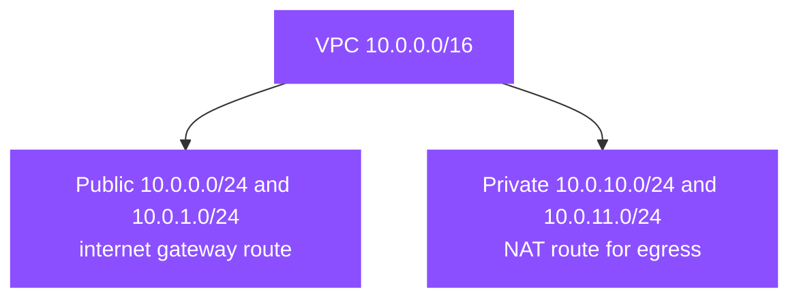

# Hands-on project: design and build a two-tier VPC address plan

This is the topic's practice project. It turns the CIDR math in [01-concepts.md](01-concepts.md) and [02-aws-addressing.md](02-aws-addressing.md) into a plan you build and verify with the AWS CLI. Nothing depends on it; it depends only on this topic.

## Goal

Design a VPC CIDR and subnet layout for a two-tier application in two Availability Zones, build it, and prove that the public and private split, the reserved addresses, and the route tables behave as the topic describes.

## What you build

A single VPC of `10.0.0.0/16` holding four subnets across two AZs: two public (for a load balancer) and two private (for the app), plus an internet gateway and a NAT gateway. The point is the address plan, not the app.



## Prerequisites

- Read [01-concepts.md](01-concepts.md), [02-aws-addressing.md](02-aws-addressing.md), and [05-limits-defaults.md](05-limits-defaults.md) first.
- An AWS account and the AWS CLI configured for a Region with at least two AZs (this uses `us-east-2`).
- Work in a disposable account or project tag; the cleanup step removes everything.

## Steps

1. **Choose the VPC CIDR.** A `/16` gives 65,536 addresses, which is room to split into many subnets. Confirm the usable math: `/16` minus the five reserved addresses per subnet.

2. **Create the VPC.**

   ```bash
   aws ec2 create-vpc --cidr-block 10.0.0.0/16 --region us-east-2 \
     --tag-specifications 'ResourceType=vpc,Tags=[{Key=Name,Value=lab-vpc}]' \
     --query 'Vpc.VpcId' --output text
   ```

3. **Create the four subnets**, two per AZ. Note that AWS reserves the first four and the last address of each.

   ```bash
   aws ec2 create-subnet --vpc-id vpc-EXAMPLE --cidr-block 10.0.0.0/24 \
     --availability-zone us-east-2a --tag-specifications 'ResourceType=subnet,Tags=[{Key=Name,Value=pub-2a}]'
   aws ec2 create-subnet --vpc-id vpc-EXAMPLE --cidr-block 10.0.1.0/24 \
     --availability-zone us-east-2b --tag-specifications 'ResourceType=subnet,Tags=[{Key=Name,Value=pub-2b}]'
   aws ec2 create-subnet --vpc-id vpc-EXAMPLE --cidr-block 10.0.10.0/24 \
     --availability-zone us-east-2a --tag-specifications 'ResourceType=subnet,Tags=[{Key=Name,Value=priv-2a}]'
   aws ec2 create-subnet --vpc-id vpc-EXAMPLE --cidr-block 10.0.11.0/24 \
     --availability-zone us-east-2b --tag-specifications 'ResourceType=subnet,Tags=[{Key=Name,Value=priv-2b}]'
   ```

4. **Add an internet gateway** for the public subnets and a **NAT gateway** with an Elastic IP in a public subnet for the private subnets.

   ```bash
   aws ec2 create-internet-gateway --tag-specifications 'ResourceType=internet-gateway,Tags=[{Key=Name,Value=lab-igw}]'
   aws ec2 attach-internet-gateway --vpc-id vpc-EXAMPLE --internet-gateway-id igw-EXAMPLE
   aws ec2 allocate-address --domain vpc --query 'AllocationId' --output text
   aws ec2 create-nat-gateway --subnet-id subnet-PUB2A --allocation-id eipalloc-EXAMPLE
   ```

5. **Create and associate route tables.** The public table has a `0.0.0.0/0` route to the internet gateway; the private table has a `0.0.0.0/0` route to the NAT gateway. Every table keeps its local VPC route.

   ```bash
   aws ec2 create-route-table --vpc-id vpc-EXAMPLE
   aws ec2 create-route --route-table-id rtb-PUB --destination-cidr-block 0.0.0.0/0 --gateway-id igw-EXAMPLE
   aws ec2 associate-route-table --route-table-id rtb-PUB --subnet-id subnet-PUB2A
   aws ec2 create-route --route-table-id rtb-PRIV --destination-cidr-block 0.0.0.0/0 --nat-gateway-id nat-EXAMPLE
   aws ec2 associate-route-table --route-table-id rtb-PRIV --subnet-id subnet-PRIV2A
   ```

## Validation

1. **Reserved-address math.** List the subnets and confirm each `/24` reports `AvailableIpAddressCount` of **251** (256 minus the five AWS reserves).

   ```bash
   aws ec2 describe-subnets --filters Name=vpc-id,Values=vpc-EXAMPLE \
     --query 'Subnets[].[CidrBlock,AvailabilityZone,AvailableIpAddressCount]' --output table
   ```

2. **Route tables.** Confirm the public table routes `0.0.0.0/0` to the internet gateway and the private table to the NAT gateway, and that both keep the `local` route for `10.0.0.0/16`.

   ```bash
   aws ec2 describe-route-tables --filters Name=vpc-id,Values=vpc-EXAMPLE \
     --query 'RouteTables[].Routes[].{Dest:DestinationCidrBlock,GW:GatewayId,NAT:NatGatewayId,Local:Origin}' --output table
   ```

## Failure injection

- **Overlap.** Try to create a second VPC with `10.0.0.0/24` (inside the first) and attempt peering. The connection is created but traffic does not flow, because peering requires non-overlapping CIDRs. This is the failure [03-troubleshooting.md](03-troubleshooting.md) describes.
- **No public route.** Remove the `0.0.0.0/0` route from the public table and confirm a resource in that subnet loses internet reachability even though it still has a public address.

## Cleanup

Delete in dependency order: NAT gateway, release the Elastic IP, detach and delete the internet gateway, then the subnets, route tables, and VPC.

```bash
aws ec2 delete-nat-gateway --nat-gateway-id nat-EXAMPLE
aws ec2 release-address --allocation-id eipalloc-EXAMPLE
aws ec2 detach-internet-gateway --internet-gateway-id igw-EXAMPLE --vpc-id vpc-EXAMPLE
aws ec2 delete-internet-gateway --internet-gateway-id igw-EXAMPLE
aws ec2 delete-subnet --subnet-id subnet-EXAMPLE   # repeat per subnet
aws ec2 delete-route-table --route-table-id rtb-EXAMPLE
aws ec2 delete-vpc --vpc-id vpc-EXAMPLE
```

## What it practices

- **Domain 5, Task 5.1 (network connectivity):** Skill 5.1.1, configure a VPC (subnets, route tables, internet and NAT gateways). Sizing subnets and placing the gateways is the task.
- **Domain 5, Task 5.3 (network troubleshooting):** Skill 5.3.1, diagnose subnet, route-table, and NAT problems; the failure injection exercises the overlap and missing-route cases.

## Sources

- AWS: *VPC CIDR blocks*. https://docs.aws.amazon.com/vpc/latest/userguide/vpc-cidr-blocks.html
- AWS: *Subnet sizing and reserved addresses*. https://docs.aws.amazon.com/vpc/latest/userguide/configure-subnets.html
