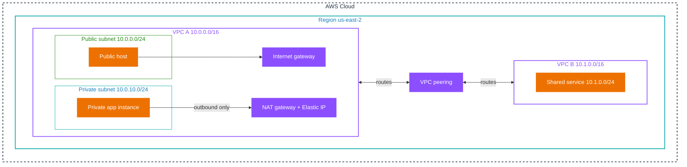
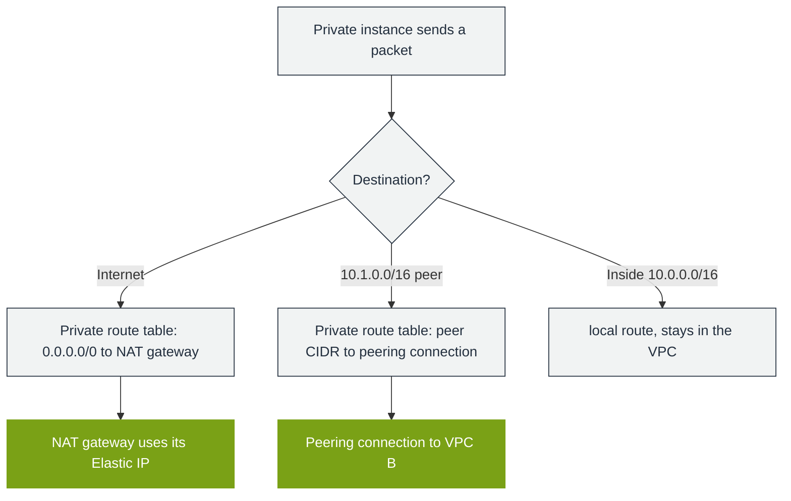

# Hands-on project: build a peered, two-tier VPC network

This is the topic's practice project. It takes every address concept documented in this folder and puts them into one build: CIDR sizing, the reserved addresses, public and private subnets, the internet gateway, the NAT gateway with an Elastic IP, route tables, and VPC peering with non-overlapping ranges. Nothing depends on it; it depends only on this topic.

## Goal

Stand up two VPCs joined by peering, with a public and a private subnet on one side, and prove that the addressing rules (reserved addresses, public/private routing, and non-overlapping peering) hold.

## What you build

Two VPCs and the gateways that connect them:

- **VPC A** `10.0.0.0/16` hosts the application: a public subnet `10.0.0.0/24` and a private subnet `10.0.10.0/24`, an internet gateway, and a NAT gateway with an Elastic IP for the private subnet's outbound traffic.
- **VPC B** `10.1.0.0/16` hosts a shared service in `10.1.0.0/24`.
- A **VPC peering** connection joins A and B. The two blocks do not overlap, which is the peering precondition.



## Concepts covered

| Concept | Document | Where it appears in the build |
|---------|----------|-------------------------------|
| CIDR notation and host math | [01-concepts.md](01-concepts.md) | Choosing `/16` and `/24` blocks |
| Network and broadcast, reserved addresses | [02-aws-addressing.md](02-aws-addressing.md) | The 251 usable addresses check |
| Allowed subnet sizes | [05-limits-defaults.md](05-limits-defaults.md) | `/16` VPC, `/24` subnets |
| Public versus private addresses | [02-aws-addressing.md](02-aws-addressing.md) | Public subnet versus private subnet |
| Internet gateway | [02-aws-addressing.md](02-aws-addressing.md) | Public subnet route |
| NAT gateway and Elastic IP | [02-aws-addressing.md](02-aws-addressing.md) | Private subnet outbound |
| Route tables and the local route | [02-aws-addressing.md](02-aws-addressing.md) | Both tables keep `local` |
| VPC peering and non-overlap | [03-troubleshooting.md](03-troubleshooting.md) | A to B peering |

## Prerequisites

- Read [01-concepts.md](01-concepts.md), [02-aws-addressing.md](02-aws-addressing.md), and [05-limits-defaults.md](05-limits-defaults.md) first.
- AWS CLI configured for `us-east-2`, and permission to create VPCs, subnets, gateways, and peering connections.

## Steps

1. **Create both VPCs and turn on DNS hostnames.** DNS support makes the peering usable by name.

   ```bash
   aws ec2 create-vpc --cidr-block 10.0.0.0/16 --region us-east-2 \
     --tag-specifications 'ResourceType=vpc,Tags=[{Key=Name,Value=vpc-a}]'
   aws ec2 create-vpc --cidr-block 10.1.0.0/16 --region us-east-2 \
     --tag-specifications 'ResourceType=vpc,Tags=[{Key=Name,Value=vpc-b}]'
   aws ec2 modify-vpc-attribute --vpc-id vpc-A --enable-dns-hostnames
   ```

2. **Create the subnets in VPC A**, one public and one private, in different AZs.

   ```bash
   aws ec2 create-subnet --vpc-id vpc-A --cidr-block 10.0.0.0/24 --availability-zone us-east-2a
   aws ec2 create-subnet --vpc-id vpc-A --cidr-block 10.0.10.0/24 --availability-zone us-east-2b
   aws ec2 create-subnet --vpc-id vpc-B --cidr-block 10.1.0.0/24 --availability-zone us-east-2a
   ```

3. **Create the internet gateway and the NAT gateway.** The NAT gateway needs an Elastic IP and lives in the public subnet.

   ```bash
   aws ec2 create-internet-gateway
   aws ec2 attach-internet-gateway --vpc-id vpc-A --internet-gateway-id igw-A
   aws ec2 allocate-address --domain vpc --query 'AllocationId' --output text
   aws ec2 create-nat-gateway --subnet-id subnet-PUBA --allocation-id eipalloc-A
   ```

4. **Create route tables.** The public table routes `0.0.0.0/0` to the internet gateway; the private table routes `0.0.0.0/0` to the NAT gateway. Both keep the automatic `local` route.

   ```bash
   aws ec2 create-route-table --vpc-id vpc-A
   aws ec2 create-route --route-table-id rtb-PUB --destination-cidr-block 0.0.0.0/0 --gateway-id igw-A
   aws ec2 associate-route-table --route-table-id rtb-PUB --subnet-id subnet-PUBA
   aws ec2 create-route --route-table-id rtb-PRIV --destination-cidr-block 0.0.0.0/0 --nat-gateway-id nat-A
   aws ec2 associate-route-table --route-table-id rtb-PRIV --subnet-id subnet-PRIVA
   ```

5. **Create the peering connection and add routes both ways.** A peering connection alone does not route traffic; each VPC needs a route to the other's CIDR through the peering connection.

   ```bash
   aws ec2 create-vpc-peering-connection --vpc-id vpc-A --peer-vpc-id vpc-B
   aws ec2 accept-vpc-peering-connection --vpc-peering-connection-id pcx-A
   aws ec2 create-route --route-table-id rtb-PRIV --destination-cidr-block 10.1.0.0/16 --vpc-peering-connection-id pcx-A
   aws ec2 create-route --route-table-id rtb-B --destination-cidr-block 10.0.0.0/16 --vpc-peering-connection-id pcx-A
   ```

## How it works

The packet path is the point. A private instance sends outbound traffic that leaves through the NAT gateway, not the internet gateway, because the private route table carries only the NAT route. Traffic to the peering peer leaves through the peering connection because the route table has a more specific route for the peer's CIDR than the `local` route's VPC range. The `local` route always matches the VPC's own CIDR and can never be removed, so intra-VPC traffic never leaves the VPC.



## Validation

1. **Reserved-address math.** Each `/24` must report **251** available addresses, which is 256 minus the five AWS reserves (network, VPC router, DNS, a future-use address, and broadcast).

   ```bash
   aws ec2 describe-subnets --filters Name=vpc-id,Values=vpc-A \
     --query 'Subnets[].[CidrBlock,AvailabilityZone,AvailableIpAddressCount]' --output table
   ```

2. **Route tables.** The public table routes to the internet gateway, the private table to the NAT gateway, and both keep the `local` route.

   ```bash
   aws ec2 describe-route-tables --filters Name=vpc-id,Values=vpc-A \
     --query 'RouteTables[].Routes[].{Dest:DestinationCidrBlock,GW:GatewayId,NAT:NatGatewayId,PCX:VpcPeeringConnectionId,Origin:Origin}' --output table
   ```

3. **Peering state.** The connection is `active`, and both sides have a route for the peer CIDR.

   ```bash
   aws ec2 describe-vpc-peering-connections --vpc-peering-connection-ids pcx-A \
     --query 'VpcPeeringConnections[].Status.Code' --output text
   ```

## Failure injection

- **Overlap.** Create a second peering request from a VPC whose CIDR overlaps A (for example `10.0.0.0/24`). The connection is created but traffic never flows, because peering requires non-overlapping CIDRs. This is the failure [03-troubleshooting.md](03-troubleshooting.md) documents.
- **Missing route.** Delete the peering route from the private table and confirm the peer becomes unreachable even though the peering connection is still `active`.
- **No default route.** Remove the `0.0.0.0/0` route from the public table and confirm the public host loses internet reachability.

## Cleanup

Delete in dependency order.

```bash
aws ec2 delete-nat-gateway --nat-gateway-id nat-A
aws ec2 release-address --allocation-id eipalloc-A
aws ec2 delete-vpc-peering-connection --vpc-peering-connection-id pcx-A
aws ec2 detach-internet-gateway --internet-gateway-id igw-A --vpc-id vpc-A
aws ec2 delete-internet-gateway --internet-gateway-id igw-A
aws ec2 delete-subnet --subnet-id subnet-EXAMPLE   # repeat for each subnet
aws ec2 delete-route-table --route-table-id rtb-EXAMPLE   # repeat
aws ec2 delete-vpc --vpc-id vpc-A
aws ec2 delete-vpc --vpc-id vpc-B
```

## What it practices

- **Domain 5, Task 5.1 (network connectivity):** Skill 5.1.1, configure a VPC, subnets, route tables, internet and NAT gateways; and private connectivity between VPCs.
- **Domain 5, Task 5.3 (network troubleshooting):** Skill 5.3.1, diagnose subnet, route-table, NAT, and peering problems; the failure injection exercises the overlap, missing-route, and missing-default-route cases.

## Sources

- AWS: *VPC CIDR blocks*. https://docs.aws.amazon.com/vpc/latest/userguide/vpc-cidr-blocks.html
- AWS: *Subnets and reserved addresses*. https://docs.aws.amazon.com/vpc/latest/userguide/configure-subnets.html
- AWS: *VPC peering*. https://docs.aws.amazon.com/vpc/latest/peering/what-is-vpc-peering.html
- AWS: *NAT gateways*. https://docs.aws.amazon.com/vpc/latest/userguide/vpc-nat-gateway.html
