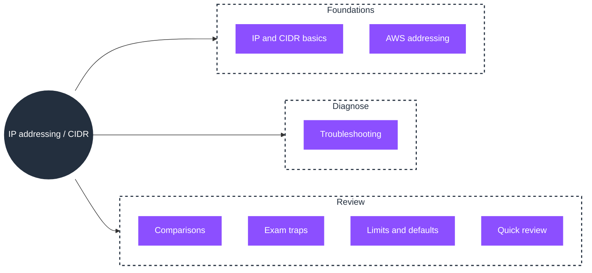

# IP addressing / CIDR

An IP address identifies a host on a network. CIDR notation (`a.b.c.d/n`) describes a *range* of addresses by fixing the leading `n` bits. AWS uses CIDR for every VPC and subnet, so subnet math decides how many resources fit and whether two networks can connect.

## What IP addressing is

CIDR answers two questions about a network:

- **Which addresses exist.** In `a.b.c.d/n`, the prefix length `n` fixes the network bits; the remaining `32 − n` bits are host bits, giving `2^(32−n)` addresses.
- **Which of those you can use.** Every network holds back the first (network) and last (broadcast) address, and AWS reserves five addresses per subnet.

AWS represents every VPC and every subnet as a CIDR block, and two networks that need to connect (peering, Transit Gateway) must not overlap.

## SOA-C03 relevance

This is the foundation for **Domain 5: Networking and Content Delivery (18%)**:

- **Skill 5.1.1**, Configure a VPC: subnets, route tables, NACLs, security groups, NAT gateways, internet gateways. You cannot size a subnet without CIDR math.
- **Skill 5.3.1**, Troubleshoot VPC configurations (subnets, route tables, NAT gateways).

It precedes VPC (roadmap step 3): a VPC divides its CIDR into subnets, and later connectivity features (VPC peering (step 11), Transit Gateway (step 12)) fail if CIDR blocks overlap. This concept is documented once here; VPC, EC2, and peering link back to it instead of repeating it.

## Topic mind map

The topic maps in one view: the seven documents grouped by what you read first, what you reach for when subnet math goes wrong, and what you review last.

Read the root as the topic and each branch as a stage: learn the notation and how AWS applies it, then diagnose exhaustion and overlap, then review the comparisons, traps, and numbers. The `## Document index` below carries the links for every leaf.

## Document index (read in this order)

1. [01-concepts.md](01-concepts.md): IP anatomy, CIDR notation, network/broadcast, and subnet math.
2. [02-aws-addressing.md](02-aws-addressing.md): how AWS applies CIDR: VPC and subnet ranges, the five reserved addresses, private vs public IP.
3. [03-troubleshooting.md](03-troubleshooting.md): diagnosing address exhaustion and overlap problems.
4. [04-comparisons.md](04-comparisons.md): CIDR vs subnet mask, public vs private IP.
5. [05-exam-traps.md](05-exam-traps.md): recurring misconceptions.
6. [06-limits-defaults.md](06-limits-defaults.md): ranges, reserved counts, and the numbers that matter.
7. [07-quick-review.md](07-quick-review.md): the must-know summary.

Each document ends with its own `Sources` section; there is no separate `sources.md`.

## Relationship map

- **Depends On**, nothing. This is the base layer of AWS networking.
- **Prerequisite For**, VPC, subnets, route tables, security groups, NAT gateway, VPC peering, and every resource that holds an IP.
- **Commonly Used With**, VPC, subnet, Elastic IP, NAT gateway, internet gateway.

See also (both documents are planned, not yet created):

- VPC (service)
- Domain 5: Networking and Content Delivery
