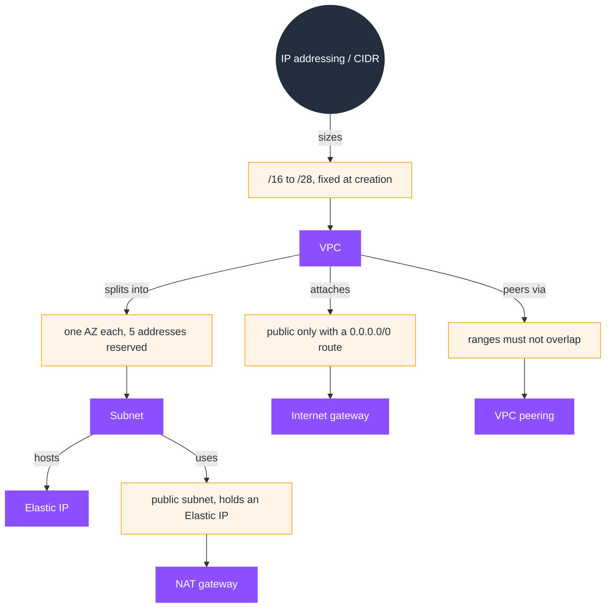

# IP addressing / CIDR

This README is the map for the IP addressing topic. An IP address identifies a host, CIDR notation describes a range, and AWS uses CIDR for every VPC and subnet, so subnet math decides capacity and connectivity. The page explains why the documents are ordered as they are and how they connect; the explanation starts in [01-concepts.md](01-concepts.md).

## What IP addressing is

CIDR answers two questions about a network:

- **Which addresses exist.** In `a.b.c.d/n`, the prefix length `n` fixes the network bits; the remaining `32 − n` bits are host bits, giving `2^(32−n)` addresses.
- **Which of those you can use.** Every network holds back the first (network) and last (broadcast) address, and AWS reserves five addresses per subnet.

AWS represents every VPC and every subnet as a CIDR block, and two networks that need to connect (peering, Transit Gateway) must not overlap.

## SOA-C03 relevance

This is the foundation for **Domain 5: Networking and Content Delivery (18%)**:

- **Skill 5.1.1**, Configure a VPC: subnets, route tables, NACLs, security groups, NAT gateways, internet gateways. You cannot size a subnet without CIDR math.
- **Skill 5.3.1**, Troubleshoot VPC configurations (subnets, route tables, NAT gateways).

It precedes VPC (roadmap step 3): a VPC divides its CIDR into subnets, and later connectivity features (VPC peering (step 11), Transit Gateway (step 12)) fail if CIDR blocks overlap. This concept is documented once here; VPC, EC2, and peering link back to it instead of repeating it.

## Topic mind map

The topic at a glance: CIDR is the addressing model every VPC construct is built from, and where two networks connect the ranges must not overlap.

Read the map outward from CIDR: the notation sizes a VPC, the VPC divides into subnets, and an address inside a subnet backs an Elastic IP or a NAT gateway. The note blocks call out the detail a line alone cannot, such as the range a VPC accepts, the addresses a subnet reserves, and the rule that two peered VPCs must not overlap. The `## Document index` below carries the links to this topic's documents.

## Document index (read in this order)

The documents are numbered in the order they build on each other.

1. [01-concepts.md](01-concepts.md): IP anatomy, CIDR notation, network/broadcast, and subnet math.
2. [02-aws-addressing.md](02-aws-addressing.md): how AWS applies CIDR: VPC and subnet ranges, the five reserved addresses, private vs public IP.
3. [03-troubleshooting.md](03-troubleshooting.md): diagnosing address exhaustion and overlap problems.
4. [04-comparisons.md](04-comparisons.md): CIDR vs subnet mask, public vs private IP.
5. [05-limits-defaults.md](05-limits-defaults.md): ranges, reserved counts, and the numbers that matter.
6. [06-quick-review.md](06-quick-review.md): the must-know summary.
7. [07-exam-questions.md](07-exam-questions.md): ten original SOA-C03 practice questions covering this topic.
8. [08-exam-traps.md](08-exam-traps.md): recurring misconceptions.
9. [09-hands-on-project.md](09-hands-on-project.md): a project that designs and builds a two-tier VPC address plan.

Each document ends with its own `Sources` section; there is no separate `sources.md`.

## Relationship map

The map below shows what this concept depends on and what builds on it.

- **Depends On**, nothing. This is the base layer of AWS networking.
- **Prerequisite For**, VPC, subnets, route tables, security groups, NAT gateway, VPC peering, and every resource that holds an IP.
- **Commonly Used With**, VPC, subnet, Elastic IP, NAT gateway, internet gateway.

See also (both documents are planned, not yet created):

- VPC (service)
- Domain 5: Networking and Content Delivery
