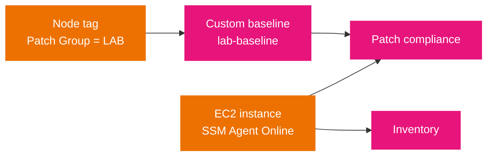

# Hands-on project: onboard a node, patch it by group, and inventory it

This is the topic's practice project. It turns the node model in [01-fundamentals.md](01-fundamentals.md) and the patching and tagging rules in [04-patch-manager.md](04-patch-manager.md) and [16-tagging.md](16-tagging.md) into a managed-node workflow you run end to end. Nothing depends on it; it depends only on this topic.

## Goal

Take one EC2 instance from unmanaged to managed, patch it through a patch group with a custom baseline, and collect its inventory, all through Systems Manager instead of a login.

## What you build

A single managed node in a patch group tied to a custom baseline, scanned with Run Command and inventoried with an association. The point is the tag-to-baseline path and the compliance output, not the app.



## Prerequisites

- Read [01-fundamentals.md](01-fundamentals.md), [04-patch-manager.md](04-patch-manager.md), and [16-tagging.md](16-tagging.md) first.
- An EC2 instance running a supported OS with the SSM Agent, and an IAM instance role that includes `ssm:UpdateInstanceInformation` (the managed policy `AmazonSSMManagedInstanceCore` grants it). A private subnet needs a NAT route or VPC endpoints to `ssm`, `ssmmessages`, and `ec2messages`.

## Steps

1. **Confirm the node is managed.** If the instance does not appear, work the four layers in [12-troubleshooting.md](12-troubleshooting.md) before continuing: agent, role, network, and IMDS.

   ```bash
   aws ssm describe-instance-information \
     --query 'InstanceInformationList[].[InstanceId,PingStatus,PlatformType,AgentVersion]' --output table
   ```

2. **Tag the node into a patch group.** The key must be exactly `Patch Group`; the value is yours.

   ```bash
   aws ec2 create-tags --resources i-0123456789abcdef0 \
     --tags Key="Patch Group",Value=LAB
   ```

3. **Create a custom baseline** so the group has a real compliance level, then register the group against it.

   ```bash
   aws ssm create-patch-baseline --name "lab-baseline" \
     --operating-system AMAZON_LINUX_2023 \
     --approval-rules '{"PatchRules":[{"PatchFilterGroup":{"PatchFilters":[{"Key":"CLASSIFICATION","Values":["Security","Bugfix"]}]},"ApproveAfterDays":7,"ComplianceLevel":"HIGH"}]}' \
     --query 'BaselineId' --output text

   aws ssm register-patch-baseline-for-patch-group \
     --baseline-id pb-0c10e65780EXAMPLE --patch-group LAB
   ```

4. **Scan the node for missing patches** with Run Command, targeting the patch group by tag.

   ```bash
   aws ssm send-command --document-name "AWS-RunPatchBaseline" \
     --targets "Key=tag:Patch Group,Values=LAB" \
     --parameters 'Operation=Scan'
   ```

5. **Collect inventory** with a State Manager association that runs on a schedule.

   ```bash
   aws ssm create-association --name "AWS-GatherSoftwareInventory" \
     --targets "Key=tag:Patch Group,Values=LAB" \
     --schedule-expression "rate(1 day)"
   ```

## Validation

1. **Node Online.** `describe-instance-information` shows `PingStatus: Online` and the agent version.

2. **Patch compliance.** The node reports against the LAB baseline.

   ```bash
   aws ssm list-compliance-summaries --filters Key=ComplianceType,Values=Patch \
     --query 'ComplianceSummaryItems[].{Id:ComplianceType,Status:Status,Count:CompliantSummary.CompliantCount}' --output table
   ```

3. **Inventory present.** The association is `Success` and inventory is returned for the node.

   ```bash
   aws ssm describe-association --association-id ASSOC-EXAMPLE \
     --query 'AssociationDescription.[Name,Status.Name]' --output text

   aws ssm get-inventory --query 'Entities[].Id' --output text
   ```

## Failure injection

- **Lost tag.** Remove the tag (`aws ec2 delete-tags --resources i-0123456789abcdef0 --tags Key="Patch Group"`) and re-run the scan. The node now resolves to the OS default baseline, so the compliance level changes, which is the fallback path [04-patch-manager.md](04-patch-manager.md) describes.
- **Broken registration.** Detach the instance role or remove `ssm:UpdateInstanceInformation` and watch the node drop to unmanaged on the next agent check-in, which is the first failure in [12-troubleshooting.md](12-troubleshooting.md).

## Cleanup

```bash
aws ssm delete-association --association-id ASSOC-EXAMPLE
aws ssm deregister-patch-baseline-for-patch-group --baseline-id pb-0c10e65780EXAMPLE --patch-group LAB
aws ssm delete-patch-baseline --baseline-id pb-0c10e65780EXAMPLE
aws ec2 delete-tags --resources i-0123456789abcdef0 --tags Key="Patch Group"
```

## What it practices

- **Domain 1, Task 1.1 (monitoring and logging):** Skill 1.1.x, track node compliance and inventory in Systems Manager.
- **Domain 3, Task 3.1 (provision and maintain):** apply patch baselines and state associations to a fleet.
- **Domain 4 (compliance):** patch compliance reporting, and the role and network prerequisites a managed node needs.

## Sources

- AWS: *AWS Systems Manager Patch Manager*. https://docs.aws.amazon.com/systems-manager/latest/userguide/patch-manager.html
- AWS: *Working with patch groups*. https://docs.aws.amazon.com/systems-manager/latest/userguide/patch-manager-patch-groups.html
- AWS: *AWS Systems Manager Inventory*. https://docs.aws.amazon.com/systems-manager/latest/userguide/systems-manager-inventory.html
