# Hands-on project: operate a small fleet end to end

This project turns the folder's Systems Manager capabilities into one fleet workflow you can run, break, and repair: managed nodes, tagging, Resource Groups, Parameter Store, Inventory, patch groups, Run Command, State Manager, Session Manager, Distributor, AppConfig, Automation, a Maintenance Window, Compliance, OpsCenter, and Fleet Manager. It is the practice half of the topic, not another explanation, and nothing else depends on it; the mechanics are in the linked documents, and the build applies them end to end.

## Goal

Take two EC2 instances from unmanaged to a fully operated fleet: patched, inventoried, configured from Parameter Store, managed by runbooks, and observable, all through Systems Manager instead of a login.

## What you build

A two-node fleet sharing one patch group, one resource group, and one configuration store, driven by Systems Manager.


## Concepts covered

The table maps each Systems Manager capability in this project to the document that explains it and the step where the build applies it.

| Capability | Document | Where it appears in the build |
|------------|----------|-------------------------------|
| VPC, subnet, route table, security group | [01-fundamentals.md](01-fundamentals.md) | Steps 1 to 3 |
| Managed nodes and the instance role | [01-fundamentals.md](01-fundamentals.md) | Steps 4 to 6 |
| Default Host Management Configuration | [01-fundamentals.md](01-fundamentals.md) | The alternative to an explicit role |
| Fleet Manager | [02-node-tools.md](02-node-tools.md) | Step 6 and Validation |
| Compliance | [02-node-tools.md](02-node-tools.md) | Steps 11 and 13, and Validation |
| Inventory and resource data sync | [02-node-tools.md](02-node-tools.md) | Step 9 |
| Run Command | [03-session-run-state.md](03-session-run-state.md) | Step 10 |
| State Manager | [03-session-run-state.md](03-session-run-state.md) | Step 11 |
| Session Manager | [03-session-run-state.md](03-session-run-state.md) | Step 12 |
| Patch Manager and baselines | [04-patch-manager.md](04-patch-manager.md) | Step 13 |
| Distributor | [05-distributor.md](05-distributor.md) | Step 14 |
| Automation, Maintenance Windows, Documents | [06-change-management.md](06-change-management.md) | Steps 15 and 16 |
| Parameter Store | [07-parameter-store.md](07-parameter-store.md) | Step 8 |
| AppConfig | [08-application-tools.md](08-application-tools.md) | Step 17 |
| Resource Groups | [09-resource-groups.md](09-resource-groups.md) | Step 7 |
| OpsCenter and Explorer | [10-operations-tools.md](10-operations-tools.md) | Step 18 |
| Tagging and tag-based targeting | [16-tagging.md](16-tagging.md) | Steps 5, 7, and 10 to 16 |

## Prerequisites

Read these first: the build assumes the agent, patching, and tagging rules they establish, and the steps do not repeat them.

- Read [01-fundamentals.md](01-fundamentals.md), [04-patch-manager.md](04-patch-manager.md), and [16-tagging.md](16-tagging.md) first.
- An AWS account with permission to create VPC, EC2, IAM, S3, and Systems Manager resources.
- AWS CLI configured for `us-east-2`, with `sts:GetCallerIdentity` permission so the scripts can read the account ID.
- The build creates the VPC, subnet, security group, role, and both instances in Steps 1 to 5. You do not need pre-existing nodes.

## Steps

The build has two phases. Phase A creates the infrastructure the nodes run on. Phase B configures Systems Manager on top of it. Each step gives the console path, the CLI equivalent, and what to check, so you can follow it in the console or script it end to end. Run the steps in order; later steps use the names and IDs created earlier.

## Phase A: Build the infrastructure

### Step 1: Create the VPC and public subnet

The nodes need outbound HTTPS to the Systems Manager endpoints, and nothing else. A public subnet with an internet gateway gives them that path without a NAT gateway or interface endpoints. If you use a private subnet instead, add a NAT gateway or interface endpoints for `ssm`, `ssmmessages`, and `ec2messages`, or the agent cannot register.

**Console:** VPC > Your VPCs > Create VPC. Choose **VPC only**, name `lab-vpc`, IPv4 CIDR `10.0.0.0/16`, tenancy Default. Then VPC > Subnets > Create subnet: VPC `lab-vpc`, name `lab-public`, Availability Zone `us-east-2a`, IPv4 CIDR `10.0.0.0/24`. After creation, select the subnet, Actions > Edit subnet settings, and enable **Enable auto-assign public IPv4 address**.

**CLI:**

```bash
VPC_ID=$(aws ec2 create-vpc --cidr-block 10.0.0.0/16 --query 'Vpc.VpcId' --output text)
aws ec2 create-tags --resources "$VPC_ID" --tags Key=Name,Value=lab-vpc
aws ec2 modify-vpc-attribute --vpc-id "$VPC_ID" --enable-dns-hostnames

SUBNET_ID=$(aws ec2 create-subnet --vpc-id "$VPC_ID" --cidr-block 10.0.0.0/24 \
  --availability-zone us-east-2a --query 'Subnet.SubnetId' --output text)
aws ec2 modify-subnet-attribute --subnet-id "$SUBNET_ID" --map-public-ip-on-launch
aws ec2 create-tags --resources "$SUBNET_ID" --tags Key=Name,Value=lab-public
```

The `/24` leaves 251 usable addresses after the five AWS reservations. The public IP assignment matters because the nodes have no NAT; without it, the agent has no route to the internet. The Create subnet form is where the containment rule is enforced:

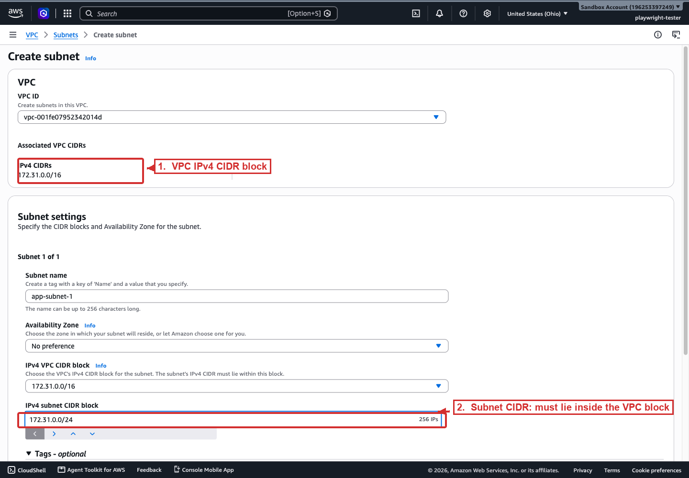

*The subnet CIDR (2) must sit inside the VPC CIDR (1). The console counts 256 addresses for the `/24`, before the five AWS reservations.*

### Step 2: Create the internet gateway and route table

The internet gateway attaches the VPC to the internet, and the route table is what makes the subnet public. The table keeps its automatic `local` route for VPC traffic; the default route you add sends everything else to the gateway.

**Console:** VPC > Internet gateways > Create internet gateway, name `lab-igw`, create it, then Actions > Attach to VPC > `lab-vpc`. VPC > Route tables > Create route table, name `lab-public-rt`, VPC `lab-vpc`. Select it, Routes > Edit routes > Add route: destination `0.0.0.0/0`, target Internet Gateway `lab-igw`. Then Subnet associations > Edit subnet associations and add `lab-public`.

**CLI:**

```bash
IGW_ID=$(aws ec2 create-internet-gateway --query 'InternetGateway.InternetGatewayId' --output text)
aws ec2 attach-internet-gateway --vpc-id "$VPC_ID" --internet-gateway-id "$IGW_ID"

RT_ID=$(aws ec2 create-route-table --vpc-id "$VPC_ID" --query 'RouteTable.RouteTableId' --output text)
aws ec2 create-route --route-table-id "$RT_ID" --destination-cidr-block 0.0.0.0/0 --gateway-id "$IGW_ID"
aws ec2 associate-route-table --route-table-id "$RT_ID" --subnet-id "$SUBNET_ID"
```

The association is the step candidates forget: a route table with the right route does nothing until it is associated with the subnet.

### Step 3: Create the security group

The security group allows outbound traffic and no inbound traffic. Systems Manager never opens a connection to the node; the agent dials out, so there is no inbound rule to add and no bastion to build.

**Console:** EC2 > Security Groups > Create security group. Name `lab-ssm-nodes`, description `SSM nodes, outbound only`, VPC `lab-vpc`. Remove any inbound rules. Keep the default outbound rule that allows all traffic, or restrict it to HTTPS (TCP 443).

**CLI:**

```bash
SG_ID=$(aws ec2 create-security-group --group-name lab-ssm-nodes \
  --description "SSM nodes, outbound only" --vpc-id "$VPC_ID" --query 'GroupId' --output text)
```

The default egress rule allows the agent to reach the SSM endpoints. The instance role, not the network rule, is what authorizes the calls.

The Create security group form is where you confirm the VPC and remove the inbound rule:

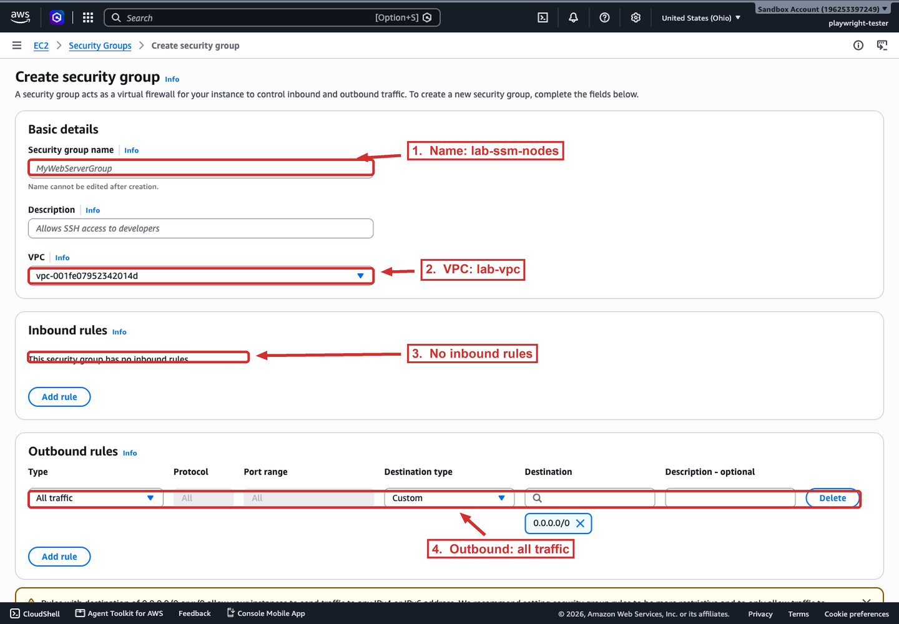

*The security group has no inbound rule (1); the outbound rule (2) is what lets the agent reach the SSM endpoints. The VPC selection (3) must match the subnet you created.*

### Step 4: Create the IAM role and instance profile

`AmazonSSMManagedInstanceCore` grants the agent `ssm:UpdateInstanceInformation` for registration and the `ssmmessages` and `ec2messages` calls for commands and sessions. The role is what makes the node manageable; the instance profile is the container that passes the role to EC2.

**Console:** IAM > Roles > Create role > AWS service > EC2 > Next. Search for `AmazonSSMManagedInstanceCore`, select it, and choose Next. Name the role `SSMInstanceRole` and create it. The console creates the instance profile with the role; you attach the role at launch in the next step.

**CLI:**

```bash
cat > trust.json <<'EOF'
{"Version":"2012-10-17","Statement":[{"Effect":"Allow","Principal":{"Service":"ec2.amazonaws.com"},"Action":"sts:AssumeRole"}]}
EOF

aws iam create-role --role-name SSMInstanceRole --assume-role-policy-document file://trust.json
aws iam attach-role-policy --role-name SSMInstanceRole \
  --policy-arn arn:aws:iam::aws:policy/AmazonSSMManagedInstanceCore
aws iam create-instance-profile --instance-profile-name SSMInstanceProfile
aws iam add-role-to-instance-profile --instance-profile-name SSMInstanceProfile \
  --role-name SSMInstanceRole
```

The trust policy is half the role: it names EC2 as the principal that may assume it. The permissions policy is the other half. A role with the right permissions and the wrong trust policy still cannot be assumed.

The console wizard runs in three steps, and the first is the trust:

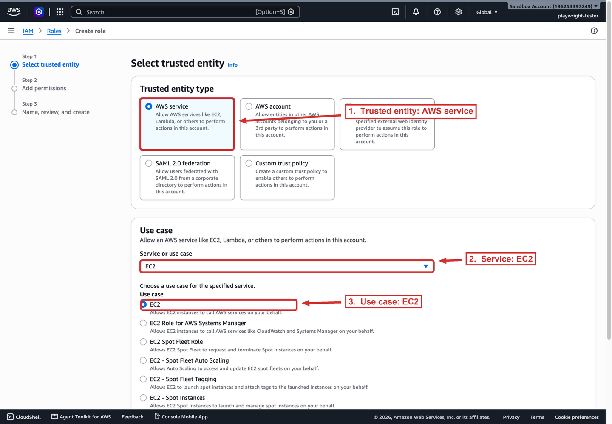

*Step 1 selects the trusted entity. Choose AWS service and EC2 (1); that choice produces the trust policy for `ec2.amazonaws.com`.*

The second step attaches the managed policy:

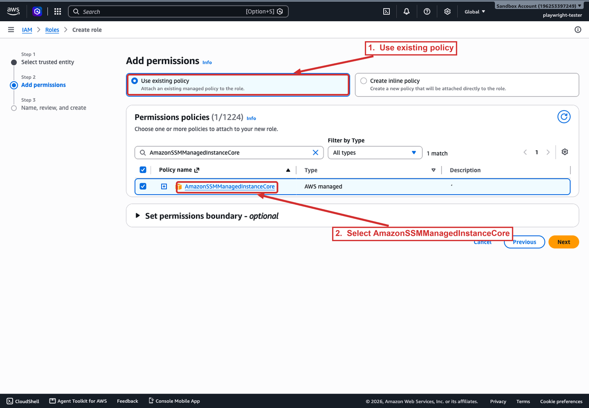

*Step 2 attaches `AmazonSSMManagedInstanceCore` (1). Search for it by name, select the check box, and continue.*

The third step names the role and creates it:

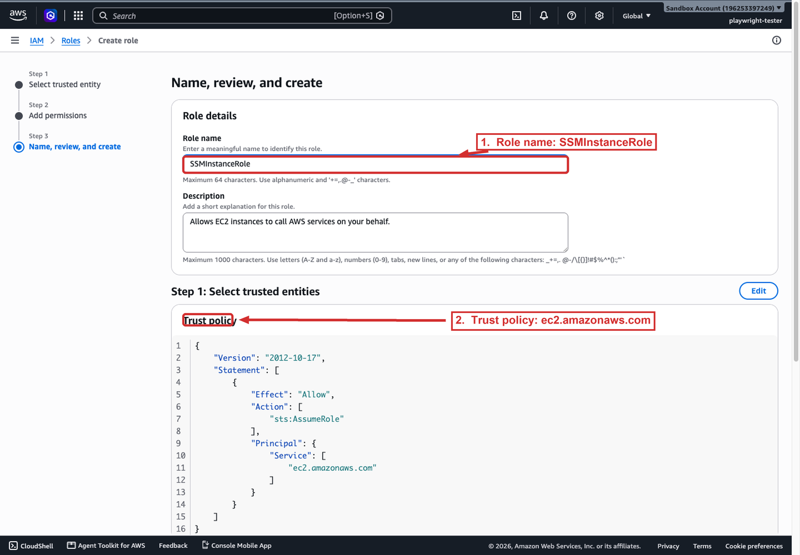

*Step 3 sets the role name (1). The instance profile is created with the role; the name is what you select on the EC2 launch form.*

### Step 5: Launch the two nodes

No key pair is needed. Session Manager provides the shell, so the instances never need an inbound SSH port or a stored key. The tags are not decoration: `Env=lab` drives the resource group and most command targets, and `Patch Group=LAB` selects the patch baseline later.

**Console:** EC2 > Instances > Launch instances. Name `node-a`, choose Amazon Linux 2023, instance type `t3.micro`, and either create a key pair or choose **Proceed without a key pair**. Under Network settings, choose VPC `lab-vpc`, subnet `lab-public`, and auto-assign public IP. Select security group `lab-ssm-nodes`. Under Advanced details > IAM instance profile, choose `SSMInstanceRole`. Add tags `Env=lab` and `Patch Group=LAB`. Launch. Repeat with the name `node-b`.

**CLI:**

```bash
AMI_ID=$(aws ssm get-parameter \
  --name /aws/service/ami-amazon-linux-latest/al2023-ami-kernel-default-x86_64 \
  --query 'Parameter.Value' --output text)

NODE_A=$(aws ec2 run-instances --image-id "$AMI_ID" --instance-type t3.micro \
  --subnet-id "$SUBNET_ID" --security-group-ids "$SG_ID" \
  --iam-instance-profile Name=SSMInstanceProfile \
  --tag-specifications 'ResourceType=instance,Tags=[{Key=Name,Value=node-a},{Key=Env,Value=lab}]' \
  --query 'Instances[0].InstanceId' --output text)
aws ec2 create-tags --resources "$NODE_A" --tags Key="Patch Group",Value=LAB

NODE_B=$(aws ec2 run-instances --image-id "$AMI_ID" --instance-type t3.micro \
  --subnet-id "$SUBNET_ID" --security-group-ids "$SG_ID" \
  --iam-instance-profile Name=SSMInstanceProfile \
  --tag-specifications 'ResourceType=instance,Tags=[{Key=Name,Value=node-b},{Key=Env,Value=lab}]' \
  --query 'Instances[0].InstanceId' --output text)
aws ec2 create-tags --resources "$NODE_B" --tags Key="Patch Group",Value=LAB
```

The screenshots below use the sandbox's `t2.micro`; the commands and the template use `t3.micro`, which is also free-tier eligible in most Regions.

The launch form is split across several sections. The name comes first, with the AMI selector below it:

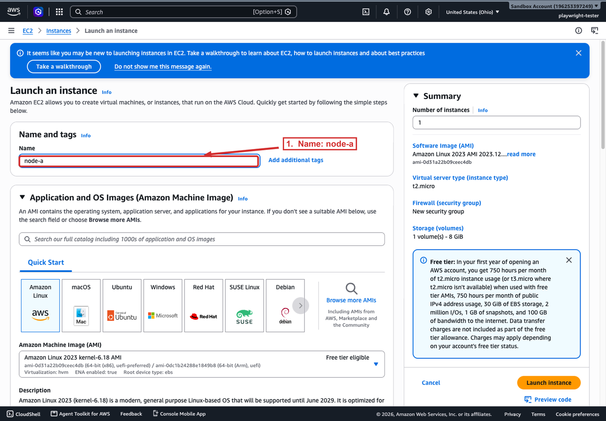

*The name (1) becomes the instance's Name tag. The Amazon Linux 2023 AMI is selected below it and ships the SSM Agent, so no agent install is needed.*

The network settings are in the middle of the form:

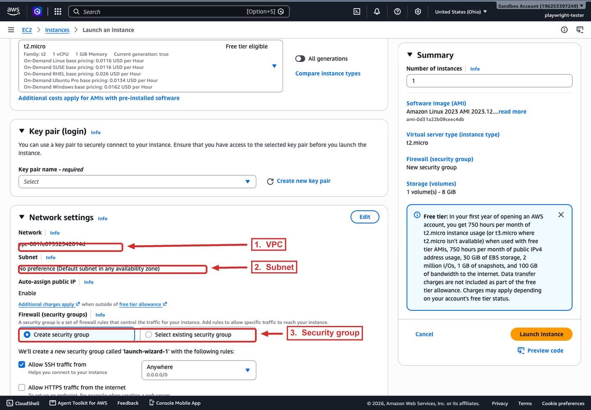

*Choose the VPC (1), the public subnet (2), and the `lab-ssm-nodes` security group (3). The sandbox screenshot shows its default VPC; use the VPC and subnet you created in Steps 1 and 2.*

The IAM instance profile is under Advanced details:

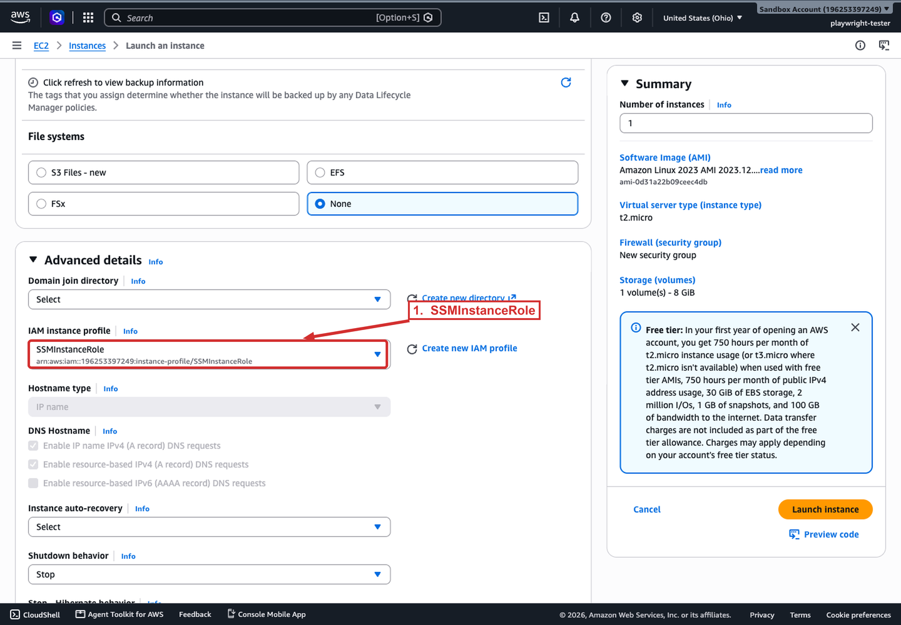

*Choose `SSMInstanceRole` (1). The profile is what makes the node eligible for Systems Manager; without it, the agent has no permission to register.*

The tags are at the bottom of the same form:

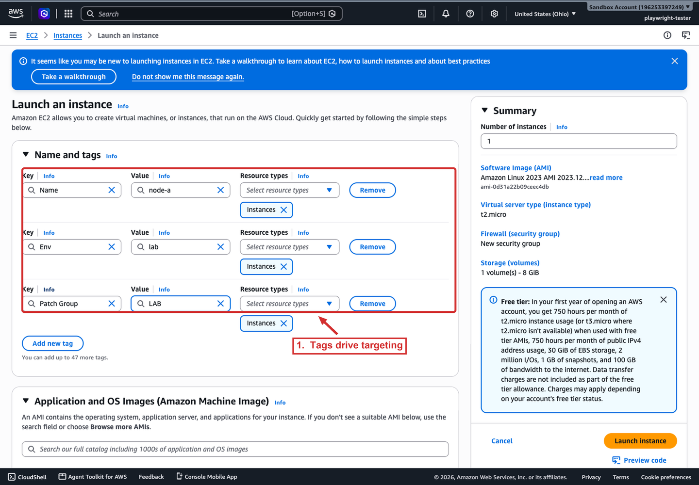

*Add `Env=lab` and `Patch Group=LAB` (1). The first drives targeting and the resource group; the second selects the patch baseline.*

### Step 6: Confirm both nodes are managed

Registration is asynchronous. The agent starts, reads its credentials, and calls `ssm:UpdateInstanceInformation`. Allow a few minutes, then confirm the status. A node that never appears is an agent, role, network, or IMDS problem, in that order.

**Console:** Systems Manager > Fleet Manager > Managed nodes. Both `node-a` and `node-b` should show `Online` with an agent version at or above the minimum.

**CLI:**

```bash
aws ssm describe-instance-information \
  --query 'InstanceInformationList[].[InstanceId,PingStatus,AgentVersion,PlatformName]' --output table
```

If a node is missing, work the four layers in [12-troubleshooting.md](12-troubleshooting.md). Do not continue until both nodes are `Online`.

The Fleet Manager view is the first proof the role and network path are correct:

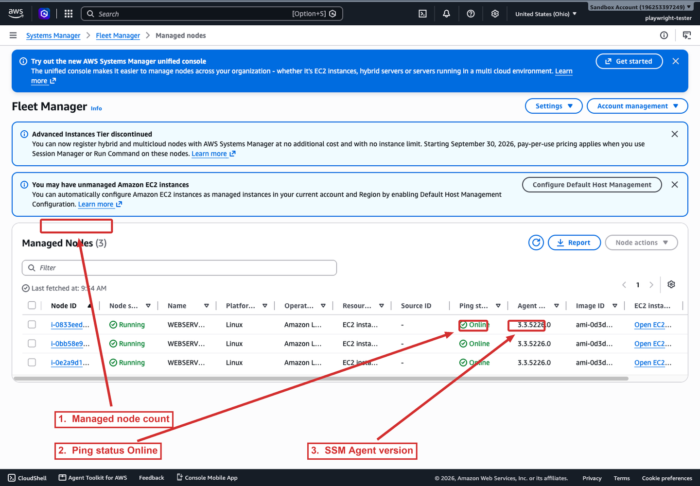

*Both nodes are `Online` (1), with the agent version and platform in the same row. A node missing here has not completed registration, regardless of its instance state.*

## Phase B: Configure Systems Manager

### Step 7: Create the resource group

The resource group turns the `Env=lab` tag into a reusable target. Commands, associations, and Maintenance Windows can then point at the group instead of a list of instance IDs, and membership follows the tag.

**Console:** Resource Groups > Create resource group. Choose **Tag based**, resource type `AWS::EC2::Instance`, tag key `Env`, value `lab`, group name `lab-fleet`, and create it.

**CLI:**

```bash
aws resource-groups create-group --name lab-fleet \
  --resource-query '{"Type":"TAG_FILTERS_1_0","Query":"{\"ResourceTypeFilters\":[\"AWS::EC2::Instance\"],\"TagFilters\":[{\"Key\":\"Env\",\"Values\":[\"lab\"]}]}"}'
```

The group is regional, so a multi-Region fleet needs one group per Region even when the tags are identical. It is also dynamic: retagging an instance moves it in or out of the group with no query edit.

The groups list is the entry point:


*The console lists the saved groups (1) and starts a new one with Create resource group (2).*

The group configuration shows the query that defines membership:


*The group is tag based (1), selects EC2 instances (2), and matches `Env=lab` (3). The member list (4) is computed from the query, not maintained by hand.*

### Step 8: Create the Parameter Store parameters

Parameter Store holds the configuration the nodes read at runtime. The plain value is for settings such as a log level; the `SecureString` is for a value that needs encryption at rest, and it requires `kms:Decrypt` on read.

**Console:** Systems Manager > Parameter Store > Create parameter. Name `/lab/config/log-level`, type `String`, value `info`, create. Then create `/lab/config/api-token` with type `SecureString` and value `example-token`.

**CLI:**

```bash
aws ssm put-parameter --name "/lab/config/log-level" --value "info" --type String
aws ssm put-parameter --name "/lab/config/api-token" --value "example-token" --type SecureString
```

The hierarchy is the access boundary: IAM can grant `ssm:GetParameter` on `/lab/config/*` without granting access to every parameter in the account.

The create form is where the type and tier are chosen:

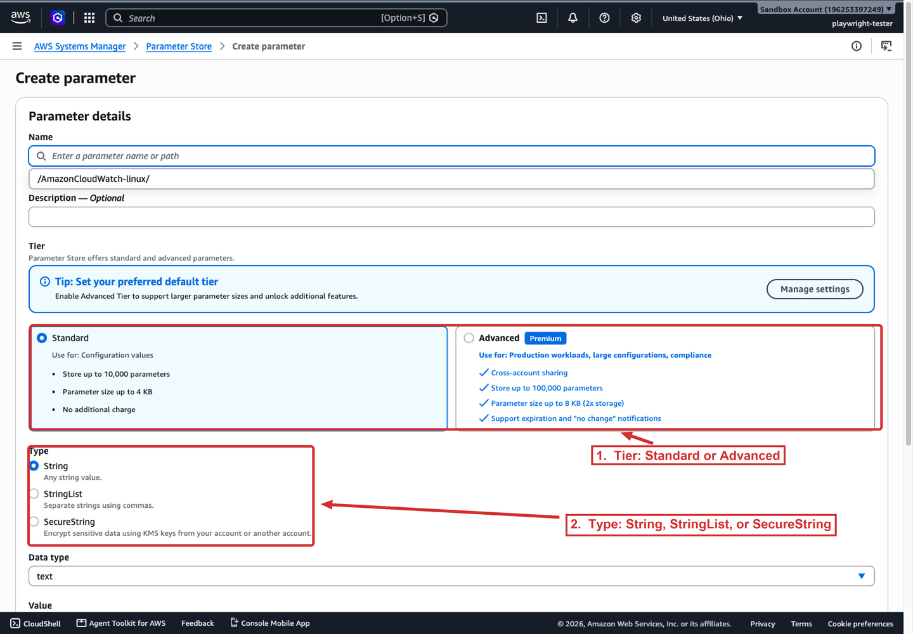

*The name (1) sets the hierarchy, and the type (2) decides whether the value is plain, a string list, or encrypted with KMS.*

The parameter list confirms both values exist:

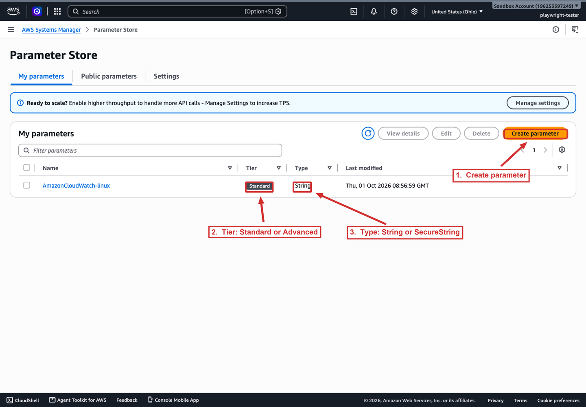

*The list shows the two `/lab/config` parameters (1). A `SecureString` value is masked in the console; the node decrypts it at read time.*

### Step 9: Collect inventory and centralize it

Inventory collects metadata, not file contents. The association runs the `AWS-GatherSoftwareInventory` document on a schedule, and the resource data sync writes the results to one S3 bucket so another account or Region can query them.

**Console:** Systems Manager > State Manager > Create association, document `AWS-GatherSoftwareInventory`, targets `Env=lab`, schedule `rate(1 day)`, create. Then Systems Manager > Inventory > Resource data syncs > Create, name `lab-inventory`, bucket `lab-ssm-inventory-<account-id>`, create. Create the bucket first if it does not exist.

**CLI:**

```bash
ACCOUNT_ID=$(aws sts get-caller-identity --query Account --output text)
BUCKET="lab-ssm-inventory-$ACCOUNT_ID"
aws s3 mb "s3://$BUCKET" --region us-east-2

cat > inventory-bucket-policy.json <<'EOF'
{"Version":"2012-10-17","Statement":[
  {"Sid":"SSMBucketPermissionsCheck","Effect":"Allow","Principal":{"Service":"ssm.amazonaws.com"},"Action":"s3:GetBucketAcl","Resource":"arn:aws:s3:::lab-ssm-inventory-ACCOUNT"},
  {"Sid":"SSMBucketDelivery","Effect":"Allow","Principal":{"Service":"ssm.amazonaws.com"},"Action":"s3:PutObject","Resource":"arn:aws:s3:::lab-ssm-inventory-ACCOUNT/*","Condition":{"StringEquals":{"s3:x-amz-acl":"bucket-owner-full-control"}}}
]}
EOF
sed -i.bak "s/ACCOUNT/$ACCOUNT_ID/g" inventory-bucket-policy.json
aws s3api put-bucket-policy --bucket "$BUCKET" --policy file://inventory-bucket-policy.json

aws ssm create-association --name "AWS-GatherSoftwareInventory" \
  --targets "Key=tag:Env,Values=lab" --schedule-expression "rate(1 day)"

aws ssm create-resource-data-sync --sync-name lab-inventory \
  --s3-destination '{"BucketName":"'$BUCKET'","BucketRegion":"us-east-2","SyncFormat":"JsonSerDe","BucketPrefix":"inventory"}'
```

The bucket policy is not optional: without the `ssm.amazonaws.com` write permission, the sync is created but stays empty. The `SyncToDestination` type is for Inventory; `SyncFromSource` is the Explorer OpsData variant.

The Inventory dashboard is where the collected data appears:

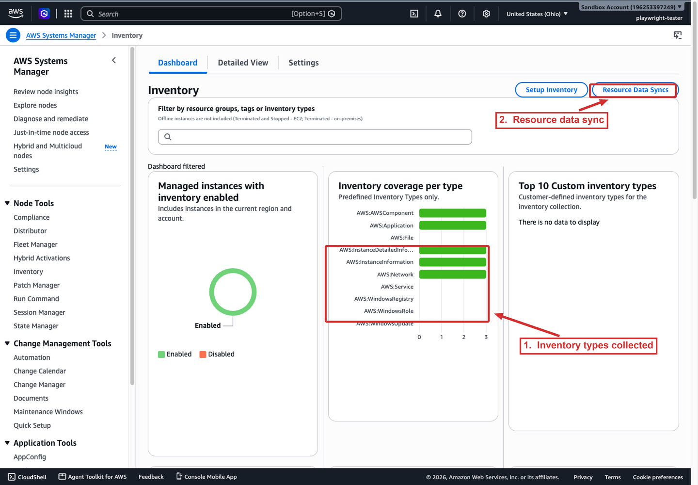

*Inventory reports the software and configuration metadata (1) collected by the association. A new node appears after its first successful collection.*

The resource data sync screen is where the central S3 destination is defined:

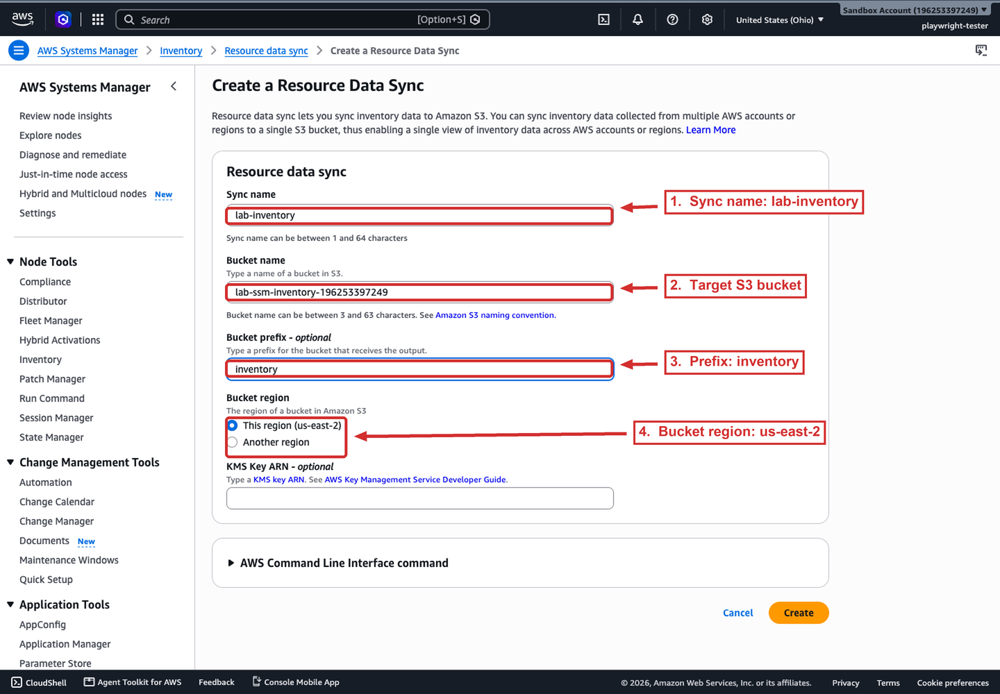

*The sync name (1), bucket (2), and optional prefix (3) decide where the aggregated inventory lands. The bucket must allow `ssm.amazonaws.com` to write.*

### Step 10: Run a command once with Run Command

Run Command is the "do this now" tool. It sends the document to every target that matches, runs it once, and records the output. It does not persist a desired state; that is State Manager.

**Console:** Systems Manager > Run Command > Run command. Choose `AWS-RunShellScript`, target the tag `Env=lab`, enter `hostname` and `uptime`, and run it. Open the invocation to read the output.

**CLI:**

```bash
COMMAND_ID=$(aws ssm send-command --document-name "AWS-RunShellScript" \
  --targets "Key=tag:Env,Values=lab" \
  --parameters 'commands=["hostname","uptime"]' \
  --query 'Command.CommandId' --output text)
aws ssm list-command-invocations --command-id "$COMMAND_ID" --details \
  --query 'CommandInvocations[].{Instance:InstanceId,Status:Status,Output:CommandPlugins[0].Output}' --output table
```

The command runs on both nodes because both carry the tag. If one node is missing from the invocation list, the target expression is wrong or the node is not managed.

The Run command form shows the document and targets:

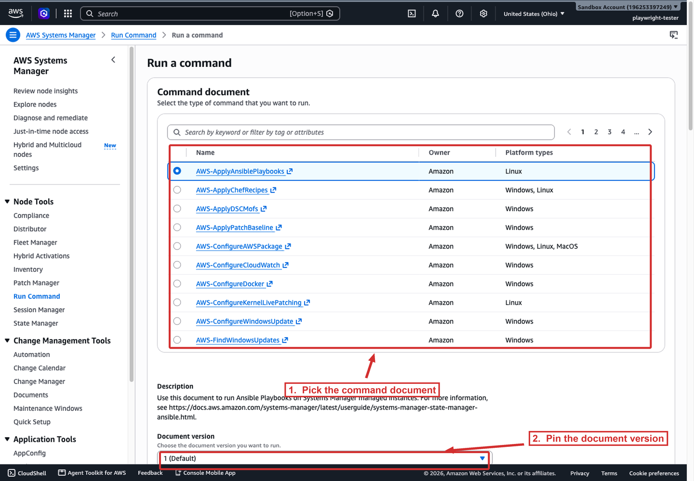

*Choose the document (1), target the tag (2), and provide the commands (3). The document version and rate controls are on the same form.*

The invocation output is the proof:

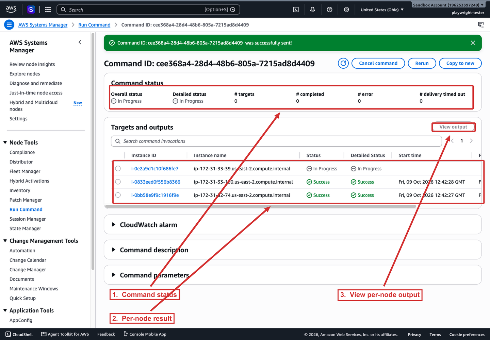

*Each target (1) reports its own status and output (2). A `Success` on both nodes confirms the tag reached the fleet.*

### Step 11: Enforce a state with State Manager

State Manager keeps a configuration applied. The association names the document, the targets, and the schedule; the schedule is what makes it self-healing rather than a one-time command.

**Console:** Systems Manager > State Manager > Create association. Document `AWS-ConfigureAWSPackage`, targets `Env=lab`, parameters `action=Install` and `name=AmazonCloudWatchAgent`, schedule `rate(7 days)`, create.

**CLI:**

```bash
aws ssm create-association --name "AWS-ConfigureAWSPackage" \
  --targets "Key=tag:Env,Values=lab" \
  --parameters 'action=Install,name=AmazonCloudWatchAgent' \
  --schedule-expression "rate(7 days)"
```

The association status is part of Compliance. A node that fails the association shows as non-compliant, which is how the fleet surfaces drift without a manual audit.

The Create association form is where the document, targets, and schedule are set:

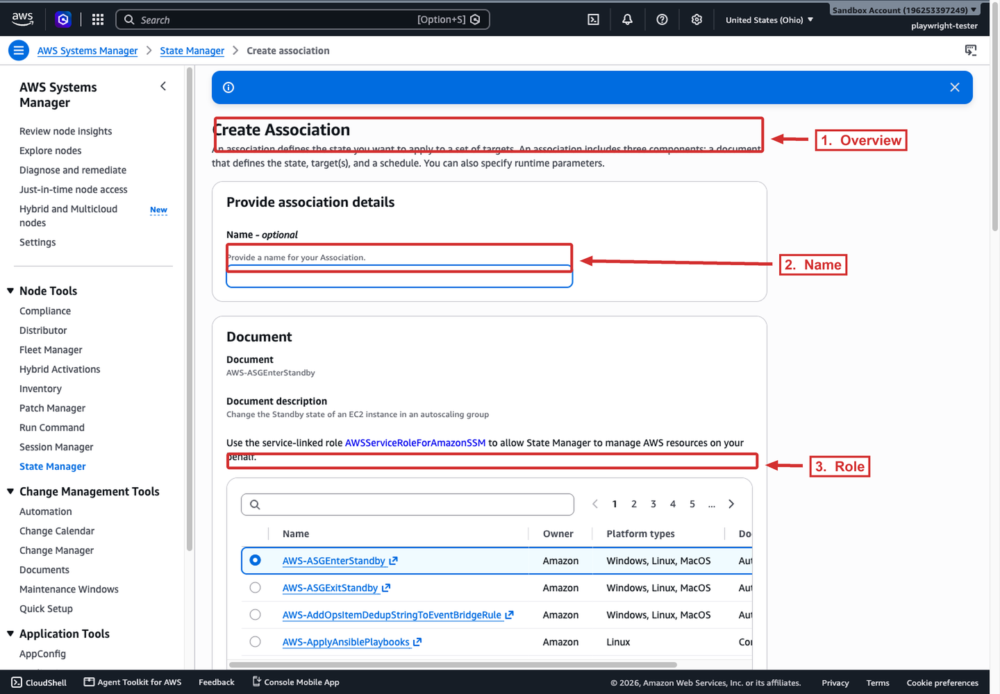

*The document (1), target selection (2), and schedule (3) are the three required pieces. The parameters section appears when the document needs input.*

### Step 12: Open a shell with Session Manager

Session Manager gives you an interactive shell through the agent's outbound channel. There is no inbound port, no bastion, and no SSH key. Access is authorized by IAM, and the session can be logged to CloudTrail, CloudWatch Logs, and S3.

**Console:** Systems Manager > Session Manager > Start session. Select `node-a` and start. In the shell, read the parameter to prove the instance role can reach Parameter Store.

**CLI:**

```bash
aws ssm start-session --target "$NODE_A"
```

Inside the session, run:

```bash
aws ssm get-parameter --name "/lab/config/log-level" --query Parameter.Value --output text
```

The command uses the instance profile, not your local credentials. If it fails with `AccessDenied`, the instance role is missing `ssm:GetParameter` or its boundary caps it.

The Start session screen selects the target:

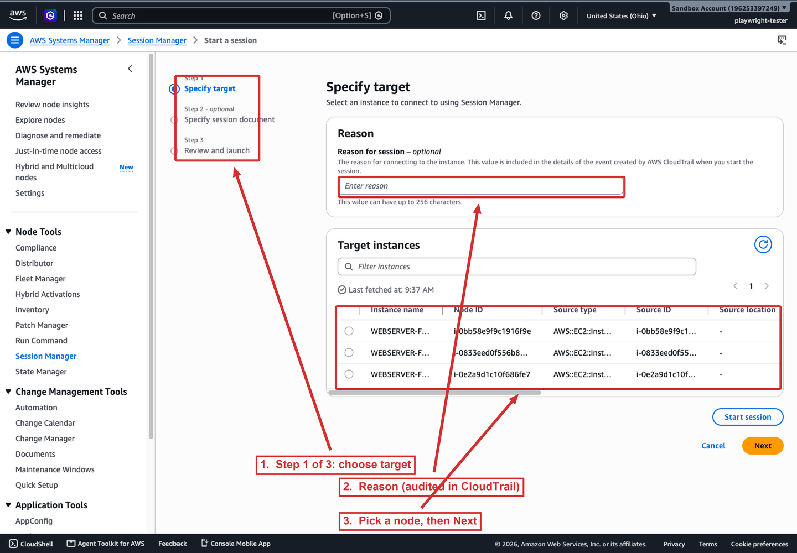

*Choose the target node (1) and start the session. The session opens in the browser or returns a CLI command, depending on the preference.*

### Step 13: Create the patch baseline and scan

The patch group tag is the bridge between the node and the baseline. The baseline decides which patches are approved; the patch group maps the node to that baseline; the scan reports the difference.

**Console:** Systems Manager > Patch Manager > Create patch baseline. Name `lab-baseline`, operating system Amazon Linux 2023, add an approval rule for classifications `Security` and `Bugfix`, approve after 7 days, compliance level `HIGH`, and create it. Then Patch Manager > Patch baselines > select the baseline > Actions > Modify patch groups, and add `LAB`. Finally Run Command with `AWS-RunPatchBaseline` and `Operation=Scan`, targeting tag `Patch Group=LAB`.

**CLI:**

```bash
BASELINE_ID=$(aws ssm create-patch-baseline --name "lab-baseline" \
  --operating-system AMAZON_LINUX_2023 \
  --approval-rules '{"PatchRules":[{"PatchFilterGroup":{"PatchFilters":[{"Key":"CLASSIFICATION","Values":["Security","Bugfix"]}]},"ApproveAfterDays":7,"ComplianceLevel":"HIGH"}]}' \
  --query 'BaselineId' --output text)
aws ssm register-patch-baseline-for-patch-group --baseline-id "$BASELINE_ID" --patch-group LAB
aws ssm send-command --document-name "AWS-RunPatchBaseline" \
  --targets "Key=tag:Patch Group,Values=LAB" --parameters 'Operation=Scan'
```

`ApproveAfterDays=7` is a deliberate buffer: a patch released today is not installed until it has been available for a week. The compliance level controls how a missing patch is reported.

The Patch Manager dashboard summarizes the fleet's patch state:

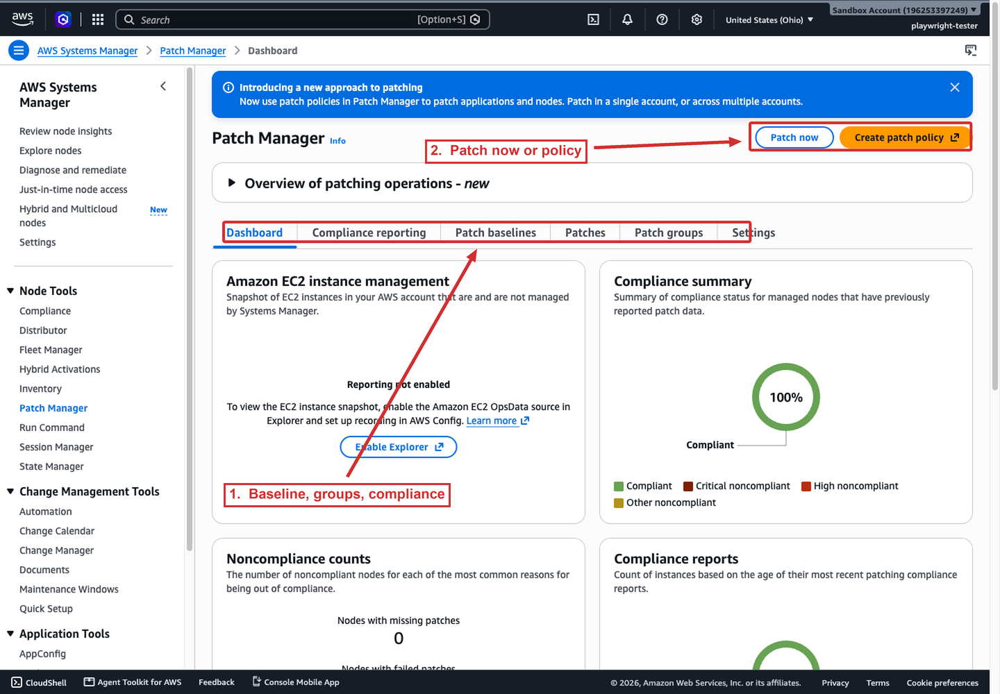

*The dashboard (1) shows compliance counts and the baselines in use. It is the first place to check after a scan.*

The baseline list shows the custom baseline and its patch group:

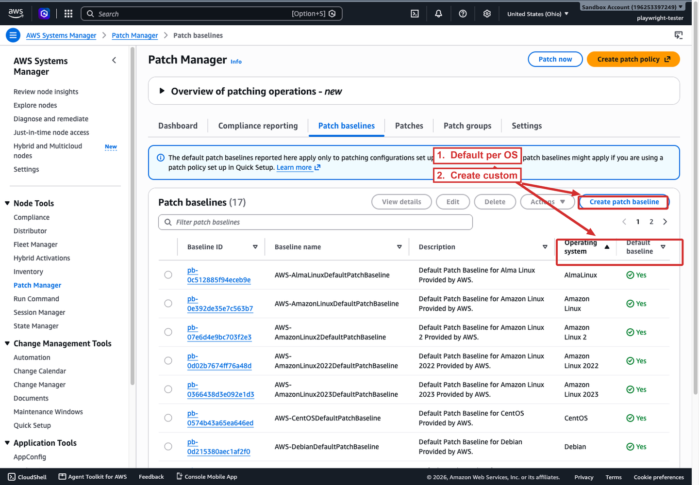

*The custom baseline (1) and its registered patch group (2) are visible in the list. The AWS default baselines remain as fallbacks.*

### Step 14: Deploy a versioned package with Distributor

Distributor is for artifacts, not one-off commands. An AWS-managed package such as `AWSPVDriver` is already published, so the install path is a Run Command call to `AWS-ConfigureAWSPackage`. For an in-house artifact, you create a package in Distributor, upload the artifact to S3, and install that package instead.

**Console:** Systems Manager > Distributor. The console lists the packages available to the account. For the install, use Run Command with `AWS-ConfigureAWSPackage`, `action=Install`, `name=AWSPVDriver`, targeting `Env=lab`.

**CLI:**

```bash
aws ssm send-command --document-name "AWS-ConfigureAWSPackage" \
  --targets "Key=tag:Env,Values=lab" \
  --parameters 'action=Install,name=AWSPVDriver'
```

The package version is the point: the same command on a new node installs the same version, which a copied shell script does not guarantee.

The Distributor page lists the packages and their versions:

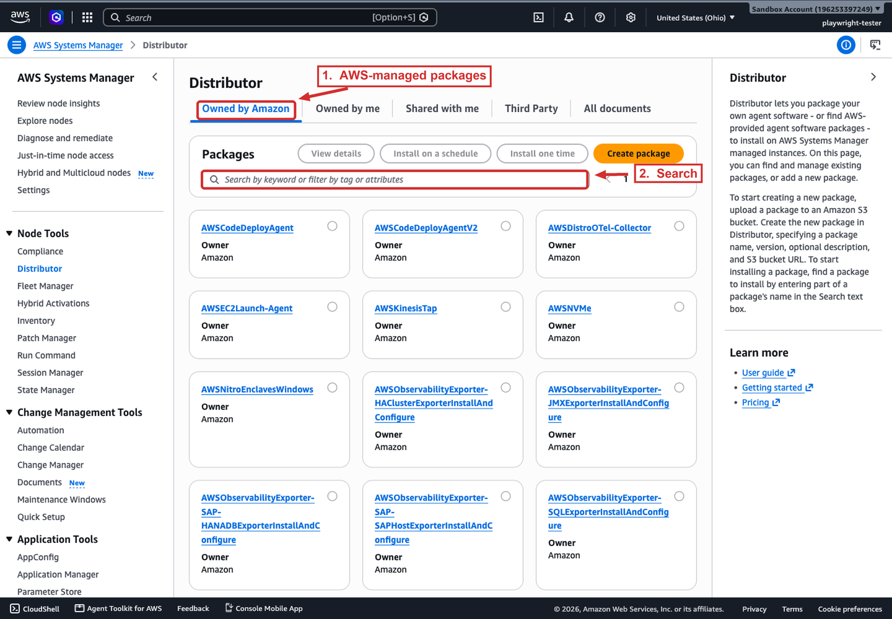

*The package list (1) shows the available packages and their versions. A custom package appears here after you create it.*

### Step 15: Run a runbook with Automation

Automation runs a workflow, not a single command. `AWS-RunPatchBaseline` is a runbook that can scan or install, and the rate controls bound how much of the fleet changes at once.

**Console:** Systems Manager > Automation > Execute runbook. Search for `AWS-RunPatchBaseline`, choose `Operation=Scan`, set Max concurrency `50%` and Max errors `1`, and execute.

**CLI:**

```bash
aws ssm start-automation-execution --document-name "AWS-RunPatchBaseline" \
  --parameters 'Operation=Scan' --max-concurrency "50%" --max-errors "1"
```

Rate control is the difference between a safe rollout and a fleet-wide outage: `50%` runs half the targets at a time, and `1` error stops new invocations.

The runbook list is where you choose the document:

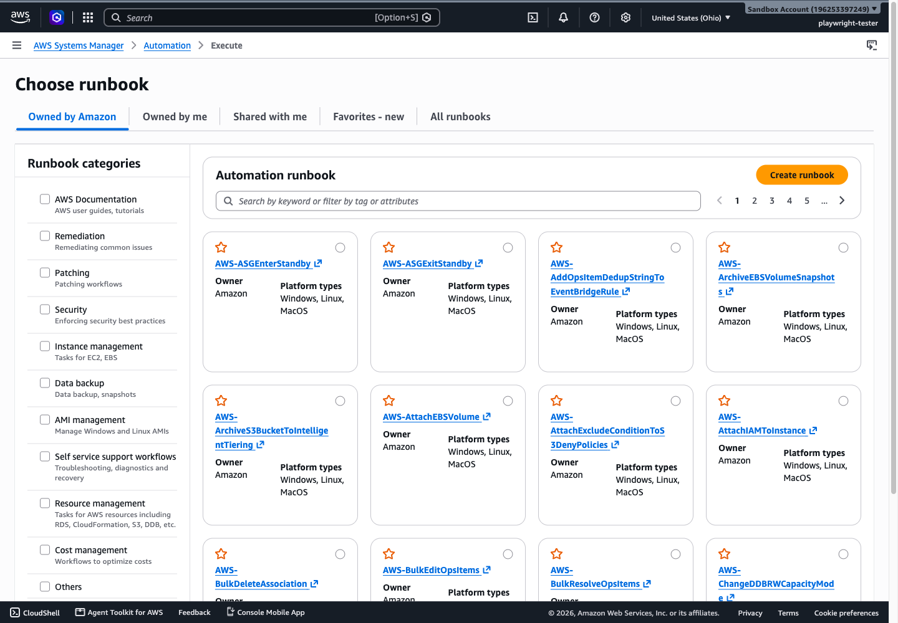

*The runbook list (1) includes the AWS-managed patch runbook. Execute opens the parameter form.*

The execute form exposes the rate controls:

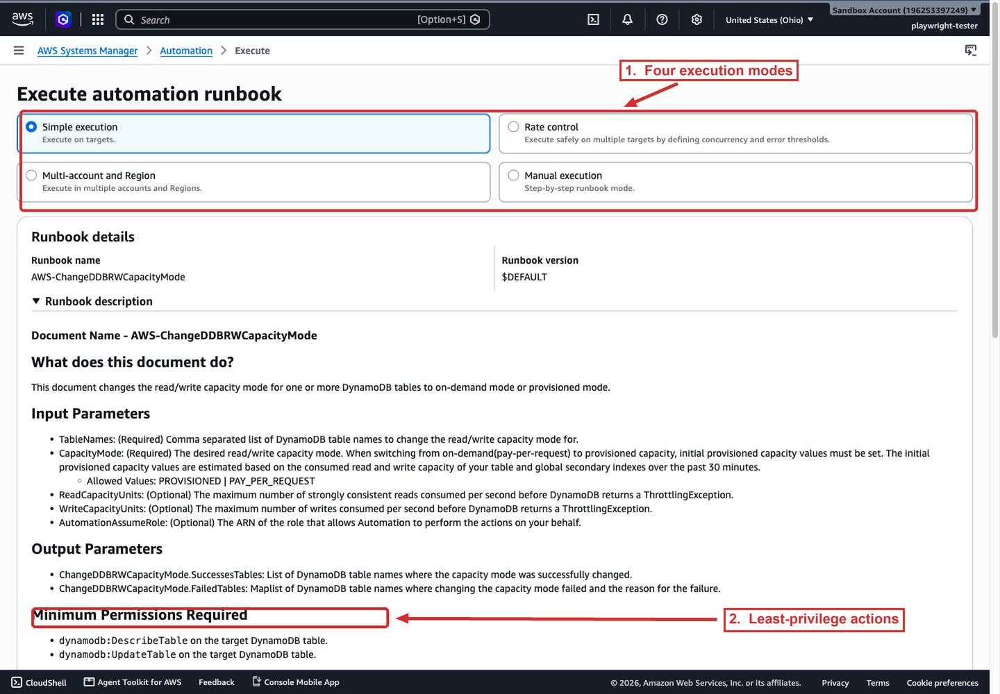

*The execution mode (1), concurrency (2), and error threshold (3) decide how the runbook spreads across the fleet.*

### Step 16: Schedule patching with a Maintenance Window and Change Calendar

A Maintenance Window bounds disruptive work to a period you choose. The target is the tag, the task is the patch document, and the Change Calendar can gate whether the window is allowed to run.

**Console:** Systems Manager > Maintenance Windows > Create maintenance window. Name `lab-weekly-patch`, schedule `cron(0 3 ? * SUN *)`, duration 3 hours, cutoff 1 hour, allow unassociated targets. Then open the window, register target `Patch Group=LAB`, and register a Run Command task `AWS-RunPatchBaseline` with `Operation=Install` and `RebootOption=RebootIfNeeded`. Systems Manager > Change Calendar > Create calendar, name `lab-freeze`, create.

**CLI:**

```bash
WINDOW_ID=$(aws ssm create-maintenance-window --name "lab-weekly-patch" \
  --schedule "cron(0 3 ? * SUN *)" --duration 3 --cutoff 1 --allow-unassociated-targets \
  --query 'WindowId' --output text)
TARGET_ID=$(aws ssm register-target-with-maintenance-window --window-id "$WINDOW_ID" \
  --resource-type INSTANCE --targets "Key=tag:Patch Group,Values=LAB" \
  --query 'WindowTargetId' --output text)
aws ssm register-task-with-maintenance-window --window-id "$WINDOW_ID" \
  --task-type RUN_COMMAND --task-arn AWS-RunPatchBaseline --priority 1 \
  --max-concurrency 50% --max-errors 1 \
  --targets "Key=WindowTargetIds,Values=$TARGET_ID" \
  --task-invocation-parameters '{"RunCommand":{"Parameters":{"Operation":["Install"],"RebootOption":["RebootIfNeeded"]}}}'

aws ssm create-document --name "lab-freeze" --document-type "ChangeCalendar" \
  --content 'BEGIN:VCALENDAR
VERSION:2.0
PRODID:-//AWS//Change Calendar//EN
END:VCALENDAR'
```

The window is not a scheduler for a single command; it is a bounded change period with a cutoff, so work that starts too late does not run past the window.

The window list is the overview:

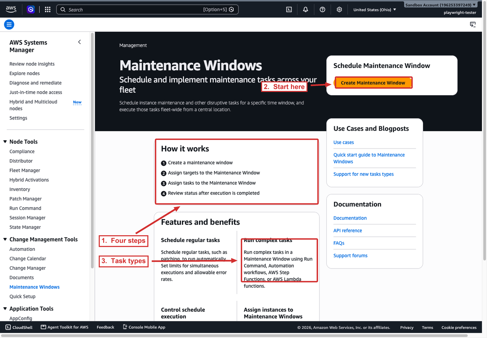

*The window list (1) shows the schedule and state. Open a window to register its targets and tasks.*

The create form sets the schedule, duration, and cutoff:

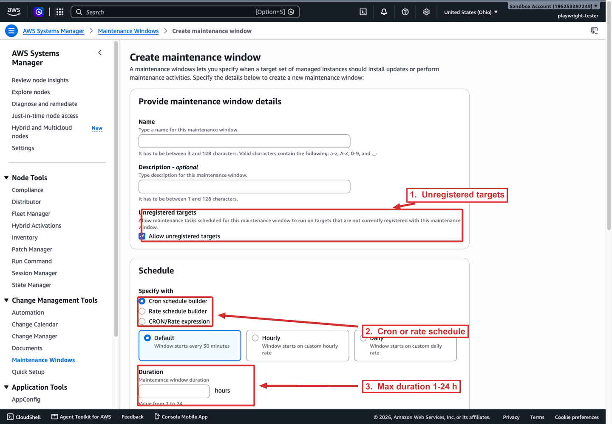

*The schedule (1), duration (2), and cutoff (3) define the change period. The target and task are registered after the window exists.*

### Step 17: Serve validated configuration with AppConfig

AppConfig adds validation and rollback to configuration changes. The configuration profile points at a source; for this project the source is an SSM document of type `ApplicationConfiguration`, which keeps the configuration in the same account and avoids an S3 bucket.

**Console:** Systems Manager > Documents > Create document > type `ApplicationConfiguration`, name `lab-config`, content `{"logLevel":"info","featureFlag":true}`, create. Then Systems Manager > AppConfig > Create application, name `lab-app`. Create a configuration profile `lab-profile`, source `ssm-document://lab-config`, type `AWS.Freeform`. Create an environment `lab-env`.

**CLI:**

```bash
aws ssm create-document --name "lab-config" --document-type "ApplicationConfiguration" \
  --content '{"logLevel":"info","featureFlag":true}'

APP_ID=$(aws appconfig create-application --name "lab-app" --query 'Id' --output text)
aws appconfig create-configuration-profile --application-id "$APP_ID" --name "lab-profile" \
  --location-uri "ssm-document://lab-config" --type AWS.Freeform
aws appconfig create-environment --application-id "$APP_ID" --name "lab-env"
```

The document is the source, the profile is the pointer, and the environment is the deployment target. A change is deployed as a configuration version under a deployment strategy, which is where validators and automatic rollback apply.

The AppConfig application is the container for the profile and environment:

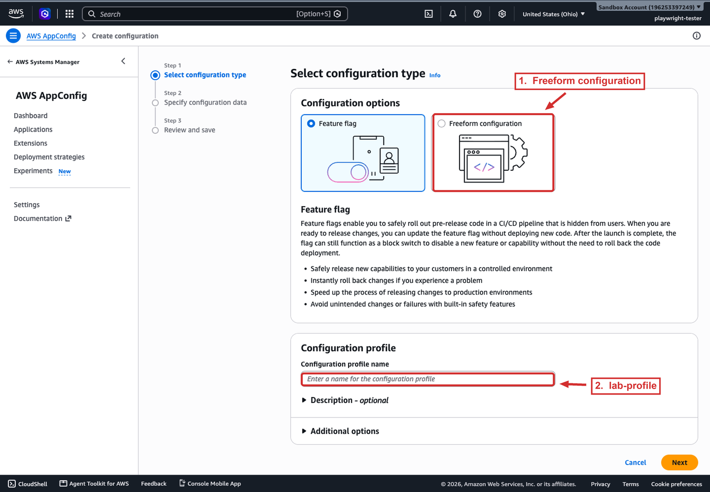

*The application name (1) is the top-level container. The configuration profile and environment are created inside it.*

### Step 18: Raise an OpsItem

OpsCenter is the work queue. An OpsItem carries the context an operator needs: the title, the source, the priority, and the affected resource. Creating one from the console or the CLI is the same API.

**Console:** Systems Manager > OpsCenter > Create OpsItem. Title `Lab fleet needs an audit`, source `Custom`, priority `3`, add a description and the affected instances, create.

**CLI:**

```bash
aws ssm create-ops-item --title "Lab fleet needs an audit" --source "Custom" \
  --priority 3 --description "Review patch compliance and inventory for the lab fleet."
```

The OpsItem is the handoff from detection to remediation. It can link a runbook, so the operator who picks it up has the fix in the same place.

The OpsCenter overview is the queue entry point:


*The overview (1) summarizes open OpsItems and their sources. Create OpsItem starts a new work item.*

The create form captures the context:


*The title (1), source (2), and priority (3) are the minimum. The description and related resources make the item actionable.*

The queue shows the item after creation:


*The OpsItems list (1) shows the new item and its status. Open it to add a runbook or resolve it.*

## Infrastructure as code (CloudFormation)

The steps above work the fleet by hand. The template below builds the same infrastructure in one stack: the VPC, the two nodes with the instance role and the `Env=lab` and `Patch Group=LAB` tags, the resource group, the parameters, the inventory bucket and its data sync, the inventory and state-manager associations, the patch baseline registered to the `LAB` patch group, the maintenance window with its target and patch task, the Change Calendar document, the `lab-config` document, and the AppConfig application. The latest Amazon Linux 2023 AMI is resolved from a public SSM parameter at deploy time, so no AMI ID is pinned. CloudFormation cannot create an OpsCenter OpsItem, because there is no OpsItem resource type, so step 13 covers that part.

Save it as `ssm-fleet.yaml`:

```yaml
AWSTemplateFormatVersion: "2010-09-09"
Description: Systems Manager fleet workflow for the SSM hands-on project

Parameters:
  LatestAmiId:
    Type: AWS::SSM::Parameter::Value<AWS::EC2::Image::Id>
    Default: /aws/service/ami-amazon-linux-latest/al2023-ami-kernel-default-x86_64
  InventoryBucketName:
    Type: String
    Default: example-ssm-inventory-111122223333

Resources:
  Vpc:
    Type: AWS::EC2::VPC
    Properties:
      CidrBlock: 10.0.0.0/16
      EnableDnsSupport: true
      EnableDnsHostnames: true
      Tags:
        - Key: Name
          Value: lab-vpc

  PublicSubnet:
    Type: AWS::EC2::Subnet
    Properties:
      VpcId: !Ref Vpc
      CidrBlock: 10.0.0.0/24
      AvailabilityZone: !Select [0, !GetAZs ""]
      MapPublicIpOnLaunch: true
      Tags:
        - Key: Name
          Value: lab-public

  InternetGateway:
    Type: AWS::EC2::InternetGateway

  GatewayAttachment:
    Type: AWS::EC2::VPCGatewayAttachment
    Properties:
      VpcId: !Ref Vpc
      InternetGatewayId: !Ref InternetGateway

  RouteTable:
    Type: AWS::EC2::RouteTable
    Properties:
      VpcId: !Ref Vpc

  DefaultRoute:
    Type: AWS::EC2::Route
    DependsOn: GatewayAttachment
    Properties:
      RouteTableId: !Ref RouteTable
      DestinationCidrBlock: 0.0.0.0/0
      GatewayId: !Ref InternetGateway

  SubnetRouteTableAssociation:
    Type: AWS::EC2::SubnetRouteTableAssociation
    Properties:
      SubnetId: !Ref PublicSubnet
      RouteTableId: !Ref RouteTable

  NodeSecurityGroup:
    Type: AWS::EC2::SecurityGroup
    Properties:
      GroupDescription: outbound only for SSM managed nodes
      VpcId: !Ref Vpc
      SecurityGroupEgress:
        - IpProtocol: "-1"
          CidrIp: 0.0.0.0/0

  NodeRole:
    Type: AWS::IAM::Role
    Properties:
      AssumeRolePolicyDocument:
        Version: "2012-10-17"
        Statement:
          - Effect: Allow
            Principal:
              Service: ec2.amazonaws.com
            Action: sts:AssumeRole
      ManagedPolicyArns:
        - !Sub "arn:${AWS::Partition}:iam::aws:policy/AmazonSSMManagedInstanceCore"

  NodeInstanceProfile:
    Type: AWS::IAM::InstanceProfile
    Properties:
      Roles:
        - !Ref NodeRole

  NodeA:
    Type: AWS::EC2::Instance
    Properties:
      ImageId: !Ref LatestAmiId
      InstanceType: t3.micro
      IamInstanceProfile: !Ref NodeInstanceProfile
      SubnetId: !Ref PublicSubnet
      SecurityGroupIds:
        - !Ref NodeSecurityGroup
      Tags:
        - Key: Name
          Value: node-a
        - Key: Env
          Value: lab
        - Key: "Patch Group"
          Value: LAB

  NodeB:
    Type: AWS::EC2::Instance
    Properties:
      ImageId: !Ref LatestAmiId
      InstanceType: t3.micro
      IamInstanceProfile: !Ref NodeInstanceProfile
      SubnetId: !Ref PublicSubnet
      SecurityGroupIds:
        - !Ref NodeSecurityGroup
      Tags:
        - Key: Name
          Value: node-b
        - Key: Env
          Value: lab
        - Key: "Patch Group"
          Value: LAB

  ConfigLogLevel:
    Type: AWS::SSM::Parameter
    Properties:
      Name: /lab/config/log-level
      Type: String
      Value: info

  ConfigApiToken:
    Type: AWS::SSM::Parameter
    Properties:
      Name: /lab/config/api-token
      Type: SecureString
      Value: example-token

  LabFleetGroup:
    Type: AWS::ResourceGroups::Group
    Properties:
      Name: lab-fleet
      ResourceQuery:
        Type: TAG_FILTERS_1_0
        Query: '{"ResourceTypeFilters":["AWS::EC2::Instance"],"TagFilters":[{"Key":"Env","Values":["lab"]}]}'

  InventoryBucket:
    Type: AWS::S3::Bucket
    Properties:
      BucketName: !Ref InventoryBucketName

  InventoryBucketPolicy:
    Type: AWS::S3::BucketPolicy
    Properties:
      Bucket: !Ref InventoryBucket
      PolicyDocument:
        Version: "2012-10-17"
        Statement:
          - Sid: SSMBucketPermissionsCheck
            Effect: Allow
            Principal:
              Service: ssm.amazonaws.com
            Action: s3:GetBucketAcl
            Resource: !GetAtt InventoryBucket.Arn
          - Sid: SSMBucketDelivery
            Effect: Allow
            Principal:
              Service: ssm.amazonaws.com
            Action: s3:PutObject
            Resource: !Sub "${InventoryBucket.Arn}/*"
            Condition:
              StringEquals:
                s3:x-amz-acl: bucket-owner-full-control

  InventoryAssociation:
    Type: AWS::SSM::Association
    Properties:
      AssociationName: lab-inventory
      Name: AWS-GatherSoftwareInventory
      ScheduleExpression: rate(1 day)
      Targets:
        - Key: tag:Env
          Values:
            - lab

  InventoryDataSync:
    Type: AWS::SSM::ResourceDataSync
    Properties:
      SyncName: lab-inventory
      SyncType: SyncToDestination
      S3Destination:
        BucketName: !Ref InventoryBucket
        BucketRegion: !Ref AWS::Region
        SyncFormat: JsonSerDe
        BucketPrefix: inventory

  CloudWatchAgentAssociation:
    Type: AWS::SSM::Association
    Properties:
      AssociationName: lab-cloudwatch-agent
      Name: AWS-ConfigureAWSPackage
      ScheduleExpression: rate(7 days)
      Targets:
        - Key: tag:Env
          Values:
            - lab
      Parameters:
        action:
          - Install
        name:
          - AmazonCloudWatchAgent

  LabBaseline:
    Type: AWS::SSM::PatchBaseline
    Properties:
      Name: lab-baseline
      OperatingSystem: AMAZON_LINUX_2023
      PatchGroups:
        - LAB
      ApprovalRules:
        PatchRules:
          - PatchFilterGroup:
              PatchFilters:
                - Key: CLASSIFICATION
                  Values:
                    - Security
                    - Bugfix
            ApproveAfterDays: 7
            ComplianceLevel: HIGH

  MaintenanceWindow:
    Type: AWS::SSM::MaintenanceWindow
    Properties:
      Name: lab-weekly-patch
      Schedule: cron(0 3 ? * SUN *)
      Duration: 3
      Cutoff: 1
      AllowUnassociatedTargets: true

  MaintenanceWindowTarget:
    Type: AWS::SSM::MaintenanceWindowTarget
    Properties:
      WindowId: !Ref MaintenanceWindow
      ResourceType: INSTANCE
      Targets:
        - Key: tag:Patch Group
          Values:
            - LAB

  MaintenanceWindowTask:
    Type: AWS::SSM::MaintenanceWindowTask
    Properties:
      WindowId: !Ref MaintenanceWindow
      Priority: 1
      MaxConcurrency: "50%"
      MaxErrors: "1"
      TaskType: RUN_COMMAND
      TaskArn: AWS-RunPatchBaseline
      Targets:
        - Key: WindowTargetIds
          Values:
            - !Ref MaintenanceWindowTarget
      TaskInvocationParameters:
        MaintenanceWindowRunCommandParameters:
          Parameters:
            Operation:
              - Install
            RebootOption:
              - RebootIfNeeded

  FreezeCalendar:
    Type: AWS::SSM::Document
    Properties:
      Name: lab-freeze
      DocumentType: ChangeCalendar
      Content: |
        BEGIN:VCALENDAR
        VERSION:2.0
        PRODID:-//AWS//Change Calendar//EN
        END:VCALENDAR

  LabConfigDocument:
    Type: AWS::SSM::Document
    Properties:
      Name: lab-config
      DocumentType: ApplicationConfiguration
      Content: '{"logLevel":"info","featureFlag":true}'

  LabApp:
    Type: AWS::AppConfig::Application
    Properties:
      Name: lab-app

  LabProfile:
    Type: AWS::AppConfig::ConfigurationProfile
    Properties:
      ApplicationId: !Ref LabApp
      Name: lab-profile
      LocationUri: ssm-document://lab-config

  LabEnvironment:
    Type: AWS::AppConfig::Environment
    Properties:
      ApplicationId: !Ref LabApp
      Name: lab-env

Outputs:
  NodeAId:
    Value: !Ref NodeA
  NodeBId:
    Value: !Ref NodeB
  BaselineId:
    Value: !Ref LabBaseline
  MaintenanceWindowId:
    Value: !Ref MaintenanceWindow
  DataSyncName:
    Value: !Ref InventoryDataSync
```

Deploy and remove it:

```bash
aws cloudformation deploy --stack-name lab-ssm-fleet \
  --template-file ssm-fleet.yaml \
  --capabilities CAPABILITY_NAMED_IAM --region us-east-2

aws cloudformation delete-stack --stack-name lab-ssm-fleet --region us-east-2
```

Two parts of the workflow stay outside the template. The `CAPABILITY_NAMED_IAM` flag is required because the template creates the instance role and profile. The OpsItem from step 18 has no CloudFormation resource type, so raise it with the CLI after the stack is up. The `InventoryBucketName` parameter defaults to the example account ID, so change it if the name is taken.

## How it works

Patching is the clearest flow, because it shows the tag-to-baseline path and the two ways to trigger it. The node's `Patch Group` tag selects the baseline; the operation is either a one-time Run Command or a scheduled Maintenance Window task, and both end at the same compliance report.

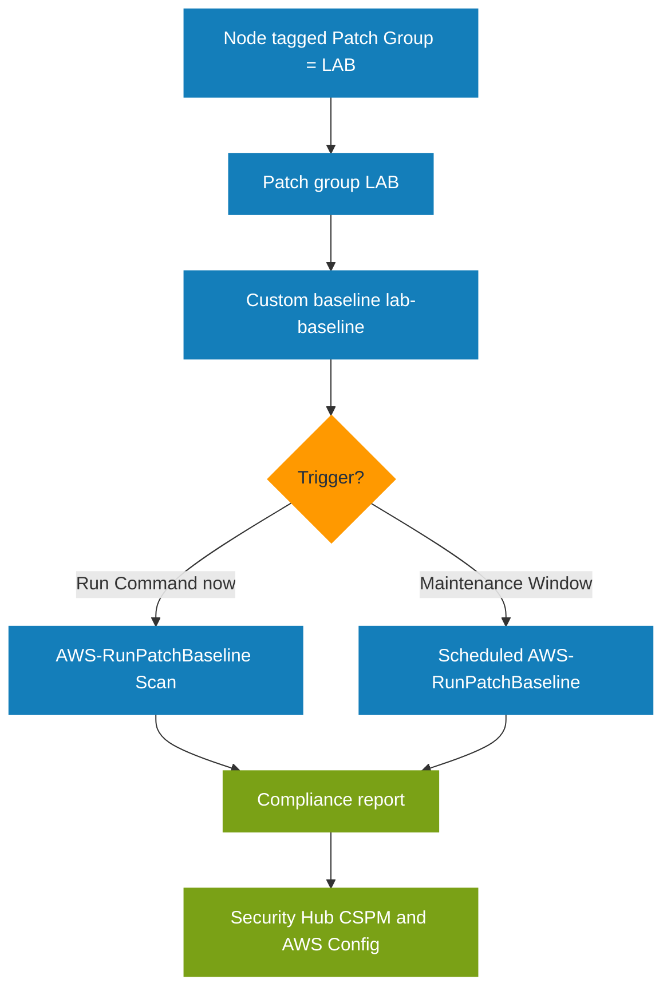

Targeting is the second flow. Every task points at the same tag, so membership changes with the tag, not with an edited list: retag a node and it joins or leaves every association, command, and patch run at once.

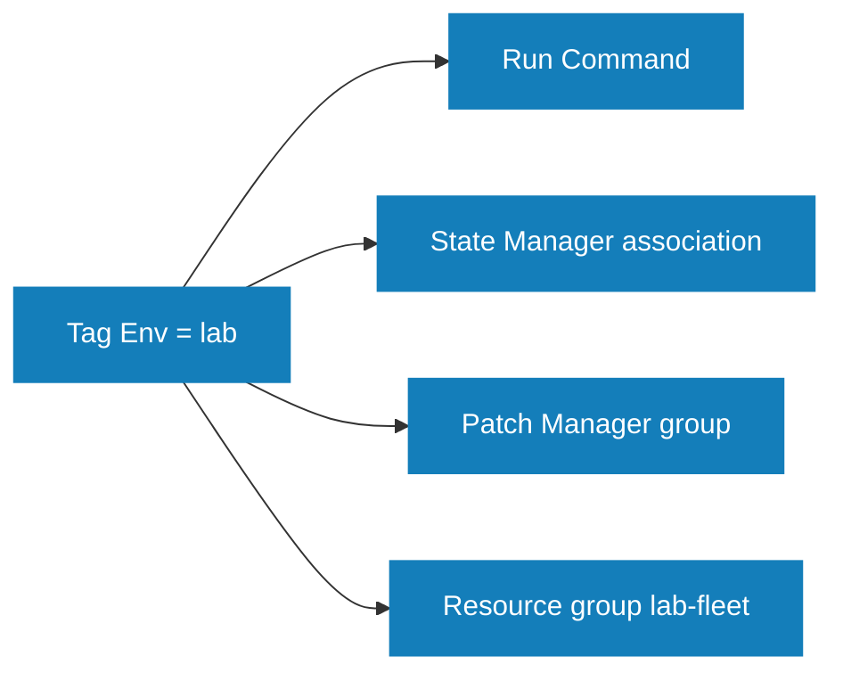

## Validation

After the build, use these checks to prove the intended behavior, not just that the resources exist; each command returns the value or state the build should produce.

1. **Fleet health.** Both nodes are `Online` with a current agent version in Fleet Manager.

   ```bash
   aws ssm describe-instance-information --query 'InstanceInformationList[].{Id:InstanceId,Status:PingStatus}' --output table
   ```

2. **Compliance.** The nodes report patch and association status.

   ```bash
   aws ssm list-compliance-summaries --query 'ComplianceSummaryItems[].{Type:ComplianceType,Compliant:CompliantSummary.CompliantCount,NonCompliant:NonCompliantSummary.NonCompliantCount}' --output table
   ```

3. **Inventory.** The association is `Success` and inventory is returned.

   ```bash
   aws ssm get-inventory --query 'Entities[].Id' --output text
   ```

4. **Parameter read from a node.** In a Session Manager shell, read the parameter with the AWS CLI using the instance role.

   ```bash
   aws ssm get-parameter --name "/lab/config/log-level" --with-decryption --query Parameter.Value
   ```

## Failure injection

Each failure removes one part of the workflow, so you can watch the symptom travel through the tag-to-baseline path; restore the part before the next test.

- **Lost tag.** Remove the `Patch Group` tag from one node and re-scan; it falls to the OS default baseline, the fallback path [04-patch-manager.md](04-patch-manager.md) describes.
- **Broken registration.** Detach the instance role on one node and watch it drop to unmanaged, the first failure in [12-troubleshooting.md](12-troubleshooting.md).
- **Association without tag.** Target an association at a tag no node carries and confirm it matches zero nodes, which is the AND rule in [16-tagging.md](16-tagging.md).
- **Missing KMS permission.** Remove `kms:Decrypt` from the node role and confirm the `SecureString` read fails after the parameter is found.

## Cleanup

Delete the configuration first, then the infrastructure. The instances must terminate before the security group can be deleted, and the internet gateway must be detached before the VPC can be removed. Run the block in the same shell where you created the variables, or re-derive them from the names.

```bash
# Systems Manager configuration
aws ssm delete-association --name "AWS-GatherSoftwareInventory"
aws ssm delete-association --name "AWS-ConfigureAWSPackage"
aws ssm delete-resource-data-sync --sync-name lab-inventory

BASELINE_ID=$(aws ssm describe-patch-baselines --filters Key=NAME,Values=lab-baseline   --query 'BaselineIdentities[0].BaselineId' --output text)
aws ssm deregister-patch-baseline-for-patch-group --baseline-id "$BASELINE_ID" --patch-group LAB
aws ssm delete-patch-baseline --baseline-id "$BASELINE_ID"

WINDOW_ID=$(aws ssm describe-maintenance-windows --filters Key=Name,Values=lab-weekly-patch   --query 'WindowIdentities[0].WindowId' --output text)
aws ssm delete-maintenance-window --window-id "$WINDOW_ID"

aws ssm delete-document --name lab-freeze
aws ssm delete-document --name lab-config

APP_ID=$(aws appconfig list-applications --query 'Items[?Name==`lab-app`].Id' --output text)
aws appconfig delete-application --application-id "$APP_ID"

aws resource-groups delete-group --group-name lab-fleet
aws ssm delete-parameter --name "/lab/config/log-level"
aws ssm delete-parameter --name "/lab/config/api-token"

# Inventory bucket
aws s3 rm "s3://$BUCKET" --recursive
aws s3 rb "s3://$BUCKET"

# Instances and network
aws ec2 terminate-instances --instance-ids "$NODE_A" "$NODE_B"
aws ec2 wait instance-terminated --instance-ids "$NODE_A" "$NODE_B"

aws ec2 delete-security-group --group-id "$SG_ID"
aws ec2 detach-internet-gateway --internet-gateway-id "$IGW_ID" --vpc-id "$VPC_ID"
aws ec2 delete-internet-gateway --internet-gateway-id "$IGW_ID"
aws ec2 delete-route-table --route-table-id "$RT_ID"
aws ec2 delete-subnet --subnet-id "$SUBNET_ID"
aws ec2 delete-vpc --vpc-id "$VPC_ID"

# Instance role and profile
aws iam remove-role-from-instance-profile --instance-profile-name SSMInstanceProfile   --role-name SSMInstanceRole
aws iam delete-instance-profile --instance-profile-name SSMInstanceProfile
aws iam detach-role-policy --role-name SSMInstanceRole   --policy-arn arn:aws:iam::aws:policy/AmazonSSMManagedInstanceCore
aws iam delete-role --role-name SSMInstanceRole
```

## What it practices

The build maps to these SOA-C03 tasks and skills; use the mapping to connect the hands-on work to the exam objectives it tests.

- **Domain 1, Task 1.1 (monitoring and logging):** Fleet Manager, Inventory, Compliance, and OpsCenter.
- **Domain 1, Task 1.2 (remediation):** Automation, EventBridge-driven remediation, and OpsCenter follow-up.
- **Domain 3, Task 3.1 (provision and maintain):** patch baselines, State Manager associations, Distributor, and Maintenance Windows.
- **Domain 3, Task 3.2 (automation):** runbooks and event-driven automation.
- **Domain 4 (compliance and secrets):** patch compliance and `SecureString` storage.
- **Domain 5, Task 5.1 (network connectivity):** the VPC, subnet, route table, internet gateway, and security group that give the nodes a path to the SSM endpoints.

## Sources

The references below are the official AWS pages behind the behavior and numbers in this document; use them when a value or rule needs checking against the source.

- AWS: *AWS Systems Manager User Guide*. https://docs.aws.amazon.com/systems-manager/latest/userguide/
- AWS: *Patch Manager*. https://docs.aws.amazon.com/systems-manager/latest/userguide/patch-manager.html
- AWS: *Maintenance Windows*. https://docs.aws.amazon.com/systems-manager/latest/userguide/maintenance-windows.html
- AWS: *AWS AppConfig*. https://docs.aws.amazon.com/appconfig/latest/userguide/what-is-appconfig.html
