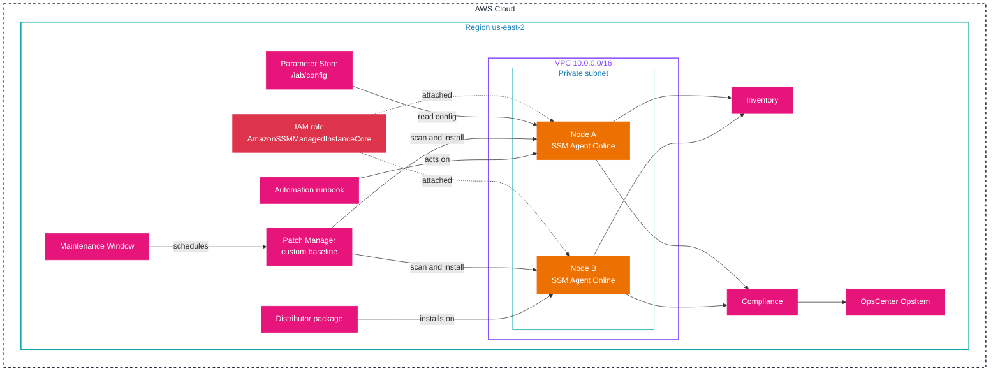
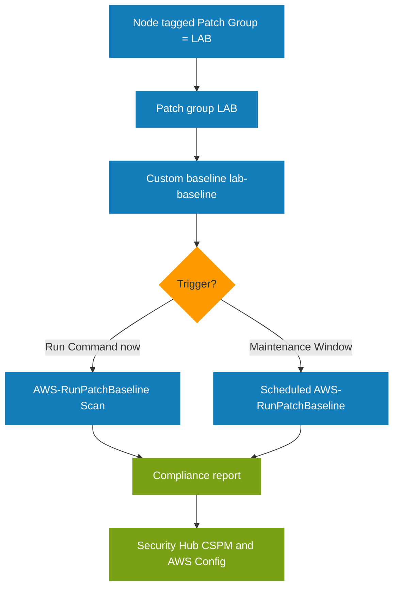
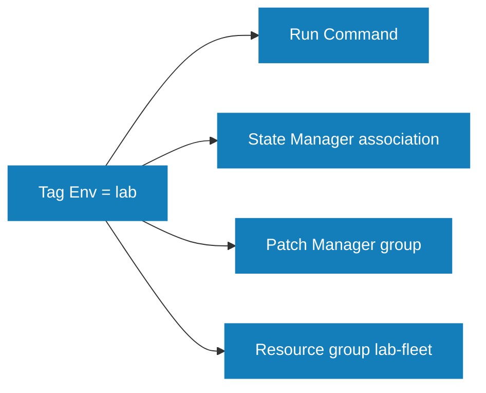

# Hands-on project: operate a small fleet end to end

This is the topic's practice project. It takes the Systems Manager capabilities documented in this folder and wires them into one fleet workflow: managed nodes and the instance role, tagging, Resource Groups, Parameter Store, Inventory with a resource data sync, Patch Manager with a patch group, Run Command, State Manager, Session Manager, Distributor, AppConfig, Automation, a Maintenance Window, Compliance, OpsCenter, and Fleet Manager. Nothing depends on it; it depends only on this topic.

## Goal

Take two EC2 instances from unmanaged to a fully operated fleet: patched, inventoried, configured from Parameter Store, managed by runbooks, and observable, all through Systems Manager instead of a login.

## What you build

A two-node fleet sharing one patch group, one resource group, and one configuration store, driven by Systems Manager.



## Concepts covered

| Capability | Document | Where it appears in the build |
|------------|----------|-------------------------------|
| Managed nodes and the instance role | [01-fundamentals.md](01-fundamentals.md) | Step 1 |
| Default Host Management Configuration | [01-fundamentals.md](01-fundamentals.md) | The alternative to an explicit role |
| Fleet Manager | [02-node-tools.md](02-node-tools.md) | Validation |
| Compliance | [02-node-tools.md](02-node-tools.md) | Validation |
| Inventory and resource data sync | [02-node-tools.md](02-node-tools.md) | Step 4 |
| Run Command | [03-session-run-state.md](03-session-run-state.md) | Step 5 |
| State Manager | [03-session-run-state.md](03-session-run-state.md) | Step 6 |
| Session Manager | [03-session-run-state.md](03-session-run-state.md) | Step 7 |
| Patch Manager and baselines | [04-patch-manager.md](04-patch-manager.md) | Step 8 |
| Distributor | [05-distributor.md](05-distributor.md) | Step 9 |
| Automation, Maintenance Windows, Documents | [06-change-management.md](06-change-management.md) | Steps 10 and 11 |
| Parameter Store | [07-parameter-store.md](07-parameter-store.md) | Step 3 |
| AppConfig | [08-application-tools.md](08-application-tools.md) | Step 12 |
| Resource Groups | [09-resource-groups.md](09-resource-groups.md) | Step 2 |
| OpsCenter and Explorer | [10-operations-tools.md](10-operations-tools.md) | Step 13 |
| Tagging and tag-based targeting | [16-tagging.md](16-tagging.md) | Everywhere a target is set |

## Prerequisites

Read these documents first; the project assumes the agent, patching, and tagging rules they explain.

- Read [01-fundamentals.md](01-fundamentals.md), [04-patch-manager.md](04-patch-manager.md), and [16-tagging.md](16-tagging.md) first.
- Two EC2 instances running a supported Linux AMI with the SSM Agent and an instance role that includes `AmazonSSMManagedInstanceCore` (or Default Host Management Configuration enabled). A private subnet needs a NAT route or VPC endpoints for `ssm`, `ssmmessages`, and `ec2messages`.
- AWS CLI configured for `us-east-2`.

## Steps

Run these in order; each step builds on the previous one.

1. **Confirm both nodes are managed.** If a node is missing, work the four layers in [12-troubleshooting.md](12-troubleshooting.md): agent, role, network, IMDS.

   ```bash
   aws ssm describe-instance-information \
     --query 'InstanceInformationList[].[InstanceId,PingStatus,AgentVersion]' --output table
   ```

2. **Tag both nodes and build a resource group.** Tags drive targeting and the group; the group is a reusable target that follows membership.

   ```bash
   aws ec2 create-tags --resources i-AAA i-BBB --tags Key=Env,Value=lab Key="Patch Group",Value=LAB
   aws resource-groups create-group --name lab-fleet \
     --resource-query '{"Type":"TAG_FILTERS_1_0","Query":"{\"ResourceTypeFilters\":[\"AWS::EC2::Instance\"],\"TagFilters\":[{\"Key\":\"Env\",\"Values\":[\"lab\"]}]}"}'
   ```

3. **Store configuration in Parameter Store.** A plain value and an encrypted value the nodes will read.

   ```bash
   aws ssm put-parameter --name "/lab/config/log-level" --value "info" --type String
   aws ssm put-parameter --name "/lab/config/api-token" --value "example-token" --type SecureString
   ```

4. **Collect inventory on a schedule** and centralize it with a resource data sync.

   ```bash
   aws ssm create-association --name "AWS-GatherSoftwareInventory" \
     --targets "Key=tag:Env,Values=lab" --schedule-expression "rate(1 day)"
   aws ssm create-resource-data-sync --sync-name lab-inventory \
     --s3-destination '{"BucketName":"example-ssm-inventory-111122223333","SyncType":"SyncFromSource","SyncSource":{"SourceType":"AWS::SSM::ManagedInstanceInventory"}}'
   ```

5. **Run a command once across the fleet** with Run Command, targeting the tag.

   ```bash
   aws ssm send-command --document-name "AWS-RunShellScript" \
     --targets "Key=tag:Env,Values=lab" \
     --parameters 'commands=["hostname","uptime"]'
   ```

6. **Enforce a state on a schedule** with State Manager so a setting self-heals.

   ```bash
   aws ssm create-association --name "AWS-ConfigureAWSPackage" \
     --targets "Key=tag:Env,Values=lab" \
     --parameters 'action=Install,name=AmazonCloudWatchAgent' \
     --schedule-expression "rate(7 days)"
   ```

7. **Open a shell with no inbound port** using Session Manager.

   ```bash
   aws ssm start-session --target i-AAA
   ```

8. **Patch by group.** Create a custom baseline, register the patch group, and scan. The node resolves to the baseline through its `Patch Group` tag.

   ```bash
   aws ssm create-patch-baseline --name "lab-baseline" --operating-system AMAZON_LINUX_2023 \
     --approval-rules '{"PatchRules":[{"PatchFilterGroup":{"PatchFilters":[{"Key":"CLASSIFICATION","Values":["Security","Bugfix"]}]},"ApproveAfterDays":7,"ComplianceLevel":"HIGH"}]}'
   aws ssm register-patch-baseline-for-patch-group --baseline-id pb-0c10e65780EXAMPLE --patch-group LAB
   aws ssm send-command --document-name "AWS-RunPatchBaseline" \
     --targets "Key=tag:Patch Group,Values=LAB" --parameters 'Operation=Scan'
   ```

9. **Deploy a versioned artifact** with Distributor through the AWS-managed package document.

   ```bash
   aws ssm send-command --document-name "AWS-ConfigureAWSPackage" \
     --targets "Key=tag:Env,Values=lab" \
     --parameters 'action=Install,name=AWSPVDriver'
   ```

10. **Run a runbook** with Automation, using rate control so the rollout is bounded.

    ```bash
    aws ssm start-automation-execution --document-name "AWS-RunPatchBaseline" \
      --parameters 'Operation=Scan' --max-concurrency "50%" --max-errors "1"
    ```

11. **Schedule the patching** inside a bounded Maintenance Window and gate it with a Change Calendar.

    ```bash
    aws ssm create-maintenance-window --name "lab-weekly-patch" \
      --schedule "cron(0 3 ? * SUN *)" --duration 3 --cutoff 1 --allow-unassociated-targets
    aws ssm create-document --name "lab-freeze" --document-type "ChangeCalendar" \
      --content 'BEGIN:VCALENDAR
VERSION:2.0
PRODID:-//AWS//Change Calendar//EN
END:VCALENDAR'
    ```

12. **Serve validated configuration** with AppConfig so a bad change rolls back.

    ```bash
    aws appconfig create-application --name lab-app
    aws appconfig create-configuration-profile --application-id APP-ID --name lab-profile \
      --location-uri ssm-document://lab-config
    ```

13. **Raise an OpsItem** for a fleet issue so it lands in the OpsCenter queue with context.

    ```bash
    aws ssm create-ops-item --title "Lab fleet needs an audit" --source "Custom" --priority 3
    ```

## Infrastructure as code (CloudFormation)

The steps above work the fleet by hand. The template below builds the same infrastructure in one stack: the VPC, the two nodes with the instance role and the `Env=lab` and `Patch Group=LAB` tags, the resource group, the parameters, the inventory bucket and its data sync, the inventory and state-manager associations, the patch baseline registered to the `LAB` patch group, the maintenance window with its target and patch task, the Change Calendar document, and the AppConfig application. The latest Amazon Linux 2023 AMI is resolved from a public SSM parameter at deploy time, so no AMI ID is pinned. CloudFormation cannot create an OpsCenter OpsItem, because there is no OpsItem resource type, so step 13 covers that part.

Save it as `ssm-fleet.yaml`:

```yaml
AWSTemplateFormatVersion: "2010-09-09"
Description: Systems Manager fleet workflow for the SSM hands-on project

Parameters:
  LatestAmiId:
    Type: AWS::SSM::Parameter::Value<AWS::EC2::Image::Id>
    Default: /aws/service/ami-amazon-linux-latest/al2023-ami-kernel-default-x86_64
  InventoryBucketName:
    Type: String
    Default: example-ssm-inventory-111122223333

Resources:
  Vpc:
    Type: AWS::EC2::VPC
    Properties:
      CidrBlock: 10.0.0.0/16
      EnableDnsSupport: true
      EnableDnsHostnames: true
      Tags:
        - Key: Name
          Value: lab-vpc

  PublicSubnet:
    Type: AWS::EC2::Subnet
    Properties:
      VpcId: !Ref Vpc
      CidrBlock: 10.0.0.0/24
      AvailabilityZone: !Select [0, !GetAZs ""]
      MapPublicIpOnLaunch: true
      Tags:
        - Key: Name
          Value: lab-public

  InternetGateway:
    Type: AWS::EC2::InternetGateway

  GatewayAttachment:
    Type: AWS::EC2::VPCGatewayAttachment
    Properties:
      VpcId: !Ref Vpc
      InternetGatewayId: !Ref InternetGateway

  RouteTable:
    Type: AWS::EC2::RouteTable
    Properties:
      VpcId: !Ref Vpc

  DefaultRoute:
    Type: AWS::EC2::Route
    DependsOn: GatewayAttachment
    Properties:
      RouteTableId: !Ref RouteTable
      DestinationCidrBlock: 0.0.0.0/0
      GatewayId: !Ref InternetGateway

  SubnetRouteTableAssociation:
    Type: AWS::EC2::SubnetRouteTableAssociation
    Properties:
      SubnetId: !Ref PublicSubnet
      RouteTableId: !Ref RouteTable

  NodeSecurityGroup:
    Type: AWS::EC2::SecurityGroup
    Properties:
      GroupDescription: outbound only for SSM managed nodes
      VpcId: !Ref Vpc
      SecurityGroupEgress:
        - IpProtocol: "-1"
          CidrIp: 0.0.0.0/0

  NodeRole:
    Type: AWS::IAM::Role
    Properties:
      AssumeRolePolicyDocument:
        Version: "2012-10-17"
        Statement:
          - Effect: Allow
            Principal:
              Service: ec2.amazonaws.com
            Action: sts:AssumeRole
      ManagedPolicyArns:
        - !Sub "arn:${AWS::Partition}:iam::aws:policy/AmazonSSMManagedInstanceCore"

  NodeInstanceProfile:
    Type: AWS::IAM::InstanceProfile
    Properties:
      Roles:
        - !Ref NodeRole

  NodeA:
    Type: AWS::EC2::Instance
    Properties:
      ImageId: !Ref LatestAmiId
      InstanceType: t3.micro
      IamInstanceProfile: !Ref NodeInstanceProfile
      SubnetId: !Ref PublicSubnet
      SecurityGroupIds:
        - !Ref NodeSecurityGroup
      Tags:
        - Key: Name
          Value: node-a
        - Key: Env
          Value: lab
        - Key: "Patch Group"
          Value: LAB

  NodeB:
    Type: AWS::EC2::Instance
    Properties:
      ImageId: !Ref LatestAmiId
      InstanceType: t3.micro
      IamInstanceProfile: !Ref NodeInstanceProfile
      SubnetId: !Ref PublicSubnet
      SecurityGroupIds:
        - !Ref NodeSecurityGroup
      Tags:
        - Key: Name
          Value: node-b
        - Key: Env
          Value: lab
        - Key: "Patch Group"
          Value: LAB

  ConfigLogLevel:
    Type: AWS::SSM::Parameter
    Properties:
      Name: /lab/config/log-level
      Type: String
      Value: info

  ConfigApiToken:
    Type: AWS::SSM::Parameter
    Properties:
      Name: /lab/config/api-token
      Type: SecureString
      Value: example-token

  LabFleetGroup:
    Type: AWS::ResourceGroups::Group
    Properties:
      Name: lab-fleet
      ResourceQuery:
        Type: TAG_FILTERS_1_0
        Query: '{"ResourceTypeFilters":["AWS::EC2::Instance"],"TagFilters":[{"Key":"Env","Values":["lab"]}]}'

  InventoryBucket:
    Type: AWS::S3::Bucket
    Properties:
      BucketName: !Ref InventoryBucketName

  InventoryBucketPolicy:
    Type: AWS::S3::BucketPolicy
    Properties:
      Bucket: !Ref InventoryBucket
      PolicyDocument:
        Version: "2012-10-17"
        Statement:
          - Sid: SSMBucketPermissionsCheck
            Effect: Allow
            Principal:
              Service: ssm.amazonaws.com
            Action: s3:GetBucketAcl
            Resource: !GetAtt InventoryBucket.Arn
          - Sid: SSMBucketDelivery
            Effect: Allow
            Principal:
              Service: ssm.amazonaws.com
            Action: s3:PutObject
            Resource: !Sub "${InventoryBucket.Arn}/*"
            Condition:
              StringEquals:
                s3:x-amz-acl: bucket-owner-full-control

  InventoryAssociation:
    Type: AWS::SSM::Association
    Properties:
      AssociationName: lab-inventory
      Name: AWS-GatherSoftwareInventory
      ScheduleExpression: rate(1 day)
      Targets:
        - Key: tag:Env
          Values:
            - lab

  InventoryDataSync:
    Type: AWS::SSM::ResourceDataSync
    Properties:
      SyncName: lab-inventory
      SyncType: SyncToDestination
      S3Destination:
        BucketName: !Ref InventoryBucket
        BucketRegion: !Ref AWS::Region
        SyncFormat: JsonSerDe
        BucketPrefix: inventory

  CloudWatchAgentAssociation:
    Type: AWS::SSM::Association
    Properties:
      AssociationName: lab-cloudwatch-agent
      Name: AWS-ConfigureAWSPackage
      ScheduleExpression: rate(7 days)
      Targets:
        - Key: tag:Env
          Values:
            - lab
      Parameters:
        action:
          - Install
        name:
          - AmazonCloudWatchAgent

  LabBaseline:
    Type: AWS::SSM::PatchBaseline
    Properties:
      Name: lab-baseline
      OperatingSystem: AMAZON_LINUX_2023
      PatchGroups:
        - LAB
      ApprovalRules:
        PatchRules:
          - PatchFilterGroup:
              PatchFilters:
                - Key: CLASSIFICATION
                  Values:
                    - Security
                    - Bugfix
            ApproveAfterDays: 7
            ComplianceLevel: HIGH

  MaintenanceWindow:
    Type: AWS::SSM::MaintenanceWindow
    Properties:
      Name: lab-weekly-patch
      Schedule: cron(0 3 ? * SUN *)
      Duration: 3
      Cutoff: 1
      AllowUnassociatedTargets: true

  MaintenanceWindowTarget:
    Type: AWS::SSM::MaintenanceWindowTarget
    Properties:
      WindowId: !Ref MaintenanceWindow
      ResourceType: INSTANCE
      Targets:
        - Key: tag:Patch Group
          Values:
            - LAB

  MaintenanceWindowTask:
    Type: AWS::SSM::MaintenanceWindowTask
    Properties:
      WindowId: !Ref MaintenanceWindow
      Priority: 1
      MaxConcurrency: "50%"
      MaxErrors: "1"
      TaskType: RUN_COMMAND
      TaskArn: AWS-RunPatchBaseline
      Targets:
        - Key: WindowTargetIds
          Values:
            - !Ref MaintenanceWindowTarget
      TaskInvocationParameters:
        MaintenanceWindowRunCommandParameters:
          Parameters:
            Operation:
              - Install
            RebootOption:
              - RebootIfNeeded

  FreezeCalendar:
    Type: AWS::SSM::Document
    Properties:
      Name: lab-freeze
      DocumentType: ChangeCalendar
      Content: |
        BEGIN:VCALENDAR
        VERSION:2.0
        PRODID:-//AWS//Change Calendar//EN
        END:VCALENDAR

  LabApp:
    Type: AWS::AppConfig::Application
    Properties:
      Name: lab-app

  LabProfile:
    Type: AWS::AppConfig::ConfigurationProfile
    Properties:
      ApplicationId: !Ref LabApp
      Name: lab-profile
      LocationUri: ssm-document://lab-config

  LabEnvironment:
    Type: AWS::AppConfig::Environment
    Properties:
      ApplicationId: !Ref LabApp
      Name: lab-env

Outputs:
  NodeAId:
    Value: !Ref NodeA
  NodeBId:
    Value: !Ref NodeB
  BaselineId:
    Value: !Ref LabBaseline
  MaintenanceWindowId:
    Value: !Ref MaintenanceWindow
  DataSyncName:
    Value: !Ref InventoryDataSync
```

Deploy and remove it:

```bash
aws cloudformation deploy --stack-name lab-ssm-fleet \
  --template-file ssm-fleet.yaml \
  --capabilities CAPABILITY_NAMED_IAM --region us-east-2

aws cloudformation delete-stack --stack-name lab-ssm-fleet --region us-east-2
```

Two parts of the workflow stay outside the template. The `CAPABILITY_NAMED_IAM` flag is required because the template creates the instance role and profile. The OpsItem from step 13 has no CloudFormation resource type, so raise it with the CLI after the stack is up. The `InventoryBucketName` parameter defaults to the example account ID, so change it if the name is taken.

## How it works

Patching is the clearest flow, because it shows the tag-to-baseline path and the two ways to trigger it. The node's `Patch Group` tag selects the baseline; the operation is either a one-time Run Command or a scheduled Maintenance Window task, and both end at the same compliance report.



Targeting is the second flow. Every task points at the same tag, so membership changes with the tag, not with an edited list: retag a node and it joins or leaves every association, command, and patch run at once.



## Validation

After the build, confirm each item below with the command shown.

1. **Fleet health.** Both nodes are `Online` with a current agent version in Fleet Manager.

   ```bash
   aws ssm describe-instance-information --query 'InstanceInformationList[].{Id:InstanceId,Status:PingStatus}' --output table
   ```

2. **Compliance.** The nodes report patch and association status.

   ```bash
   aws ssm list-compliance-summaries --query 'ComplianceSummaryItems[].{Type:ComplianceType,Compliant:CompliantSummary.CompliantCount,NonCompliant:NonCompliantSummary.NonCompliantCount}' --output table
   ```

3. **Inventory.** The association is `Success` and inventory is returned.

   ```bash
   aws ssm get-inventory --query 'Entities[].Id' --output text
   ```

4. **Parameter read from a node.** In a Session Manager shell, read the parameter with the AWS CLI using the instance role.

   ```bash
   aws ssm get-parameter --name "/lab/config/log-level" --with-decryption --query Parameter.Value
   ```

## Failure injection

Break one part of the workflow at a time and watch the failure travel through the tag-to-baseline path.

- **Lost tag.** Remove the `Patch Group` tag from one node and re-scan; it falls to the OS default baseline, the fallback path [04-patch-manager.md](04-patch-manager.md) describes.
- **Broken registration.** Detach the instance role on one node and watch it drop to unmanaged, the first failure in [12-troubleshooting.md](12-troubleshooting.md).
- **Association without tag.** Target an association at a tag no node carries and confirm it matches zero nodes, which is the AND rule in [16-tagging.md](16-tagging.md).
- **Missing KMS permission.** Remove `kms:Decrypt` from the node role and confirm the `SecureString` read fails after the parameter is found.

## Cleanup

```bash
aws ssm delete-association --association-id ASSOC-EXAMPLE     # repeat for each association
aws ssm delete-resource-data-sync --sync-name lab-inventory
aws ssm deregister-patch-baseline-for-patch-group --baseline-id pb-0c10e65780EXAMPLE --patch-group LAB
aws ssm delete-patch-baseline --baseline-id pb-0c10e65780EXAMPLE
aws ssm delete-maintenance-window --window-id mw-EXAMPLE
aws ssm delete-document --name lab-freeze
aws appconfig delete-application --application-id APP-ID
aws resource-groups delete-group --group-name lab-fleet
aws ssm delete-parameter --name "/lab/config/log-level"
aws ssm delete-parameter --name "/lab/config/api-token"
aws ec2 delete-tags --resources i-AAA i-BBB --tags Key=Env Key="Patch Group"
```

## What it practices

The project exercises the following SOA-C03 domain tasks and skills.

- **Domain 1, Task 1.1 (monitoring and logging):** Fleet Manager, Inventory, Compliance, and OpsCenter.
- **Domain 1, Task 1.2 (remediation):** Automation, EventBridge-driven remediation, and OpsCenter follow-up.
- **Domain 3, Task 3.1 (provision and maintain):** patch baselines, State Manager associations, Distributor, and Maintenance Windows.
- **Domain 3, Task 3.2 (automation):** runbooks and event-driven automation.
- **Domain 4 (compliance and secrets):** patch compliance and `SecureString` storage.

## Sources

The entries below are the AWS documentation pages this document draws on.

- AWS: *AWS Systems Manager User Guide*. https://docs.aws.amazon.com/systems-manager/latest/userguide/
- AWS: *Patch Manager*. https://docs.aws.amazon.com/systems-manager/latest/userguide/patch-manager.html
- AWS: *Maintenance Windows*. https://docs.aws.amazon.com/systems-manager/latest/userguide/maintenance-windows.html
- AWS: *AWS AppConfig*. https://docs.aws.amazon.com/appconfig/latest/userguide/what-is-appconfig.html
