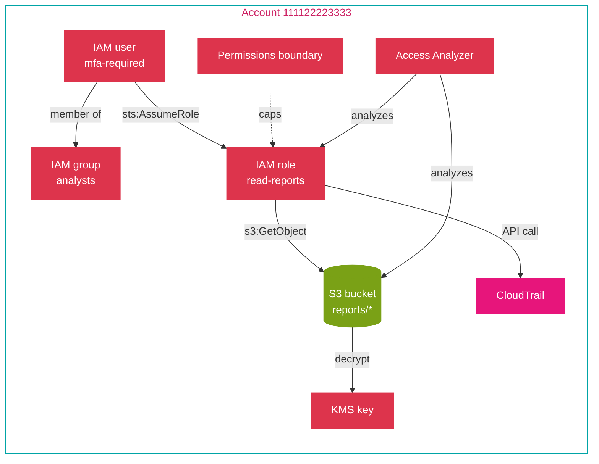
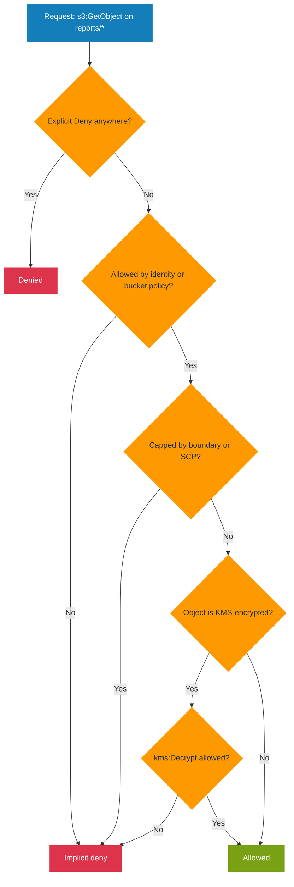

# Hands-on project: build an end-to-end identity and prove the access decision

This is the topic's practice project. It takes every IAM concept documented in this folder and puts them into one build: users and groups, roles and trust policies, identity and resource policies, a permissions boundary, an MFA condition, STS, an instance profile, a KMS key policy, Access Analyzer, and a CloudTrail audit. Nothing depends on it; it depends only on this topic.

## Goal

Build an identity that can read one encrypted S3 prefix and nothing else, prove the decision with the policy simulator, find over-broad access with Access Analyzer, and confirm the call in CloudTrail.

## What you build

An S3 bucket fronted by a KMS key, a role that a person assumes and that an instance also uses, a permissions boundary that caps the role, and an MFA-gated path. The point is the evaluation chain, not the app.



## Concepts covered

| Concept | Document | Where it appears in the build |
|---------|----------|-------------------------------|
| Users, groups, roles | [01-concepts.md](01-concepts.md) | The analyst user, the analysts group, the role |
| Policy evaluation order | [01-concepts.md](01-concepts.md) | The simulator and the explicit-deny test |
| Identity versus resource policies | [04-comparisons.md](04-comparisons.md) | The inline role policy and the S3 bucket policy |
| Managed versus inline policies | [04-comparisons.md](04-comparisons.md) | A managed policy plus an inline policy on the role |
| Trust policy | [01-concepts.md](01-concepts.md) | The role's `AssumeRole` trust relationship |
| Permissions boundary | [02-security.md](02-security.md) | The boundary that caps the role |
| MFA condition | [02-security.md](02-security.md) | The `aws:MultiFactorAuthPresent` statement |
| STS temporary credentials | [01-concepts.md](01-concepts.md) | `sts assume-role` |
| Instance profile | [04-comparisons.md](04-comparisons.md) | The role attached to an EC2 instance |
| KMS key policy | [02-security.md](02-security.md) | The key that encrypts the bucket |
| Access Analyzer | [README.md](README.md) | Findings for public or cross-account access |
| CloudTrail audit | [03-troubleshooting.md](03-troubleshooting.md) | The recorded decision and caller |

## Prerequisites

- Read [01-concepts.md](01-concepts.md), [02-security.md](02-security.md), and [03-troubleshooting.md](03-troubleshooting.md) first.
- AWS CLI configured with permission to manage IAM, S3, KMS, CloudTrail, and Access Analyzer.

## Steps

1. **Create the KMS key and the bucket.** The key policy is the default-root policy; the bucket uses SSE-KMS with that key.

   ```bash
   aws kms create-key --description "reports bucket key" --query 'KeyMetadata.KeyId' --output text
   aws s3api create-bucket --bucket example-reports-111122223333 --region us-east-2 \
     --create-bucket-configuration LocationConstraint=us-east-2
   aws s3api put-bucket-encryption --bucket example-reports-111122223333 \
     --server-side-encryption-configuration '{"Rules":[{"ApplyServerSideEncryptionByDefault":{"SSEAlgorithm":"aws:kms","KMSMasterKeyID":"KEY-ID"}}]}'
   ```

2. **Create the analyst group and user, and require MFA.** The user is a member of the group; the group carries the broad managed read-only policy, but the role is where access is scoped.

   ```bash
   aws iam create-group --group-name analysts
   aws iam create-user --user-name analyst1
   aws iam add-user-to-group --group-name analysts --user-name analyst1
   ```

3. **Create the role and its trust policy.** The role can be assumed by the account (for a person) and by EC2 (for the instance profile).

   ```json
   {
     "Version": "2012-10-17",
     "Statement": [{
       "Effect": "Allow",
       "Principal": { "Service": "ec2.amazonaws.com" },
       "Action": "sts:AssumeRole"
     }]
   }
   ```

   ```bash
   aws iam create-role --role-name read-reports --assume-role-policy-document file://trust.json
   ```

4. **Attach a permissions boundary** so the role can never exceed the listed actions, then add the least-privilege inline policy and the MFA-gated statement.

   ```bash
   aws iam put-role-permissions-boundary --role-name read-reports \
     --permissions-boundary arn:aws:iam::aws:policy/ReadOnlyAccess

   aws iam put-role-policy --role-name read-reports --policy-name read-reports-inline \
     --policy-document '{
       "Version": "2012-10-17",
       "Statement": [
         {"Effect":"Allow","Action":"s3:GetObject","Resource":"arn:aws:s3:::example-reports-111122223333/reports/*"},
         {"Effect":"Allow","Action":"kms:Decrypt","Resource":"arn:aws:kms:us-east-2:111122223333:key/KEY-ID"},
         {"Effect":"Allow","Action":"s3:GetObject","Resource":"arn:aws:s3:::example-reports-111122223333/payments/*",
          "Condition":{"Bool":{"aws:MultiFactorAuthPresent":"true"}}}
       ]
     }'
   ```

5. **Add a resource policy on the bucket** that allows the role to read, so cross-account or role-based access is explicit. Then create the instance profile and add the role.

   ```bash
   aws s3api put-bucket-policy --bucket example-reports-111122223333 --policy '{
     "Version":"2012-10-17",
     "Statement":[{"Effect":"Allow","Principal":{"AWS":"arn:aws:iam::111122223333:role/read-reports"},
       "Action":"s3:GetObject","Resource":"arn:aws:s3:::example-reports-111122223333/reports/*"}]
   }'

   aws iam create-instance-profile --instance-profile-name read-reports
   aws iam add-role-to-instance-profile --instance-profile-name read-reports --role-name read-reports
   ```

6. **Assume the role** and confirm the temporary credentials work for the allowed prefix and fail elsewhere.

   ```bash
   aws sts assume-role --role-arn arn:aws:iam::111122223333:role/read-reports \
     --role-session-name lab --query 'Credentials.AccessKeyId' --output text
   ```

7. **Create the Access Analyzer** so it scans resource policies for external access.

   ```bash
   aws accessanalyzer create-analyzer --analyzer-name lab --type ACCOUNT
   ```

## How it works

The access decision is the evaluation chain. An explicit `Deny` anywhere wins; otherwise the request needs an `Allow` in either the identity policy or the resource policy; and any boundary or SCP can only reduce the result. Reading a `SecureString`-style encrypted object needs both the S3 action and `kms:Decrypt`, which is why two statements are required.



## Validation

1. **Simulate the decision.** The allowed prefix returns `allowed`; another bucket returns `implicitDeny`.

   ```bash
   aws iam simulate-principal-policy --policy-source-arn arn:aws:iam::111122223333:role/read-reports \
     --action-names s3:GetObject \
     --resource-arns arn:aws:s3:::example-reports-111122223333/reports/q1.csv \
     --query 'EvaluationResults[].EvalDecision' --output text
   ```

2. **Access Analyzer findings.** After a few minutes, list findings; a correctly scoped role and bucket policy produce none.

   ```bash
   aws accessanalyzer list-findings --analyzer-arn arn:aws:access-analyzer:us-east-2:111122223333:analyzer/lab \
     --query 'findings[].{Resource:resource,Type:resourceType}' --output table
   ```

3. **CloudTrail.** Look up recent `GetObject` events and read `userIdentity` to confirm the role made the call.

   ```bash
   aws cloudtrail lookup-events --lookup-attributes AttributeKey=EventName,AttributeValue=GetObject \
     --max-results 5 --query 'Events[].CloudTrailEvent' --output text
   ```

## Failure injection

- **Widen the resource.** Change `Resource` to `arn:aws:s3:::example-reports-111122223333/*` and re-run the simulator against `payments/q1.csv`; it returns `allowed` without MFA, showing how an over-broad scope removes the intended boundary. What Access Analyzer flags next depends on the resource policy.
- **Explicit deny wins.** Add a `Deny` for `reports/secret/*` and confirm the simulator returns `explicitDeny` even though the `Allow` still matches. This is the rule [01-concepts.md](01-concepts.md) documents.
- **Boundary cap.** Remove the boundary and confirm a broader action that the boundary denied now succeeds, which shows a boundary can only cap.
- **Missing decrypt.** Remove the `kms:Decrypt` statement and confirm the read fails with `AccessDenied` on the encrypted object, the failure [03-troubleshooting.md](03-troubleshooting.md) describes.

## Cleanup

```bash
aws iam remove-role-from-instance-profile --instance-profile-name read-reports --role-name read-reports
aws iam delete-instance-profile --instance-profile-name read-reports
aws iam delete-role-policy --role-name read-reports --policy-name read-reports-inline
aws iam delete-role-permissions-boundary --role-name read-reports
aws iam delete-role --role-name read-reports
aws iam remove-user-from-group --group-name analysts --user-name analyst1
aws iam delete-user --user-name analyst1
aws iam delete-group --group-name analysts
aws accessanalyzer delete-analyzer --analyzer-name lab
aws s3api delete-bucket --bucket example-reports-111122223333 --region us-east-2
aws kms schedule-key-deletion --key-id KEY-ID --pending-window-in-days 7
```

## What it practices

- **Domain 4, Task 4.1 (secure access):** Skill 4.1.1, implement IAM features (users, groups, roles, instance profiles, resource policies, conditions, boundaries). Skill 4.1.2, troubleshoot and audit access with the policy simulator, Access Analyzer, and CloudTrail.
- **Domain 4, Task 4.2 (data protection):** KMS key policy and encryption on the data store.

## Sources

- AWS: *Policy evaluation logic*. https://docs.aws.amazon.com/IAM/latest/UserGuide/reference_policies_evaluation-logic.html
- AWS: *Permissions boundaries*. https://docs.aws.amazon.com/IAM/latest/UserGuide/access_policies_boundaries.html
- AWS: *iam simulate-principal-policy*. https://docs.aws.amazon.com/cli/latest/reference/iam/simulate-principal-policy.html
- AWS: *IAM Access Analyzer*. https://docs.aws.amazon.com/IAM/latest/UserGuide/what-is-access-analyzer.html
