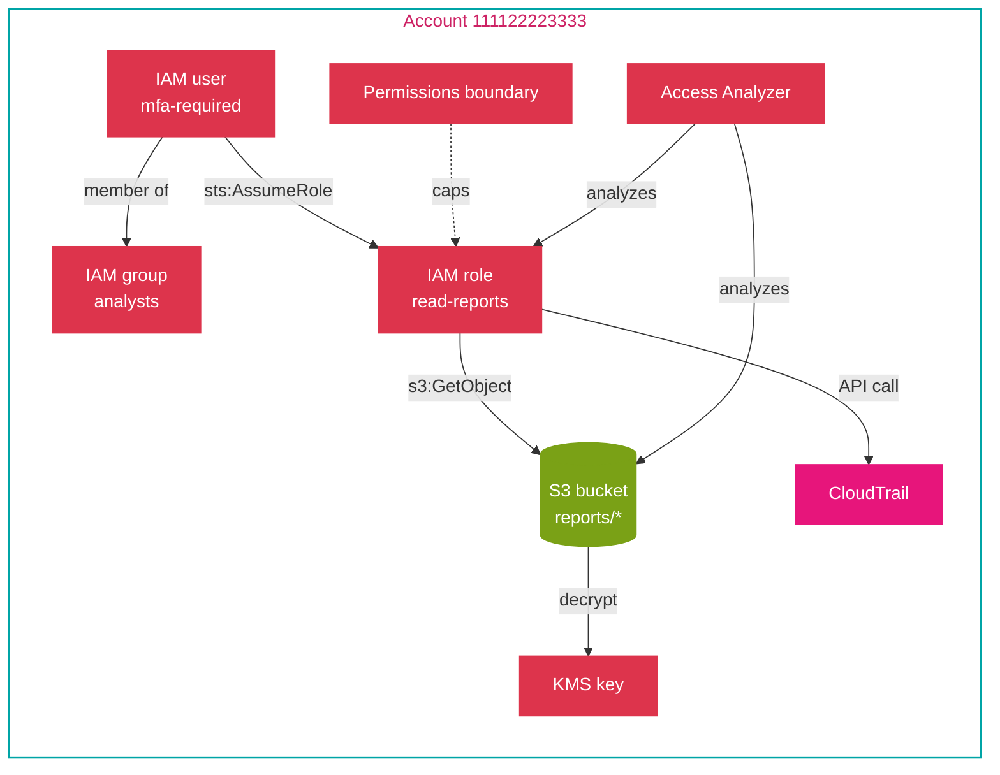
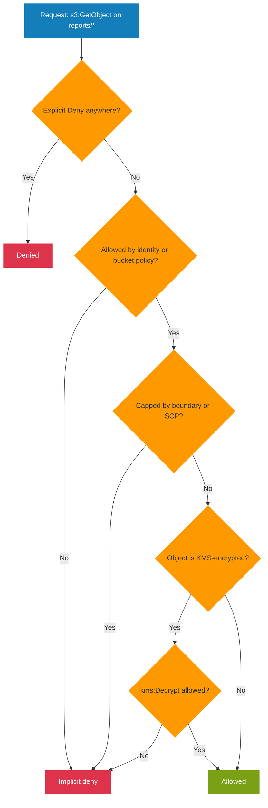

# Hands-on project: build an end-to-end identity and prove the access decision

This project turns the folder's IAM concepts into one identity chain you can build, break, and audit: a scoped role, a permissions boundary, an MFA condition, an instance profile, a KMS key policy, Access Analyzer, and CloudTrail. It is the practice half of the topic, not another explanation, and nothing else depends on it; the mechanics are in the linked documents, and the build applies them end to end.

## Goal

Build an identity that can read one encrypted S3 prefix and nothing else, prove the decision with the policy simulator, find over-broad access with Access Analyzer, and confirm the call in CloudTrail.

## What you build

An S3 bucket fronted by a KMS key, a role that a person assumes and that an instance also uses, a permissions boundary that caps the role, and an MFA-gated path. The point is the evaluation chain, not the app.



## Concepts covered

| Concept | Document | Where it appears in the build |
|---------|----------|-------------------------------|
| Users, groups, roles | [01-concepts.md](01-concepts.md) | The analyst user, the analysts group, the role |
| Policy evaluation order | [01-concepts.md](01-concepts.md) | The simulator and the explicit-deny test |
| Identity versus resource policies | [04-comparisons.md](04-comparisons.md) | The inline role policy and the S3 bucket policy |
| Managed versus inline policies | [04-comparisons.md](04-comparisons.md) | A managed policy plus an inline policy on the role |
| Trust policy | [01-concepts.md](01-concepts.md) | The role's `AssumeRole` trust relationship |
| Permissions boundary | [02-security.md](02-security.md) | The boundary that caps the role |
| MFA condition | [02-security.md](02-security.md) | The `aws:MultiFactorAuthPresent` statement |
| STS temporary credentials | [01-concepts.md](01-concepts.md) | `sts assume-role` |
| Instance profile | [04-comparisons.md](04-comparisons.md) | The role attached to an EC2 instance |
| KMS key policy | [02-security.md](02-security.md) | The key that encrypts the bucket |
| Access Analyzer | [README.md](README.md) | Findings for public or cross-account access |
| CloudTrail audit | [03-troubleshooting.md](03-troubleshooting.md) | The recorded decision and caller |

## Prerequisites

Read these documents first; the project assumes the evaluation logic and the policy types they explain.

- Read [01-concepts.md](01-concepts.md), [02-security.md](02-security.md), and [03-troubleshooting.md](03-troubleshooting.md) first.
- AWS CLI configured with permission to manage IAM, S3, KMS, CloudTrail, and Access Analyzer.

## Steps

Run these in order; each step adds one layer to the identity chain.

1. **Create the KMS key and the bucket.** The key policy is the default-root policy; the bucket uses SSE-KMS with that key.

   ```bash
   aws kms create-key --description "reports bucket key" --query 'KeyMetadata.KeyId' --output text
   aws s3api create-bucket --bucket example-reports-111122223333 --region us-east-2 \
     --create-bucket-configuration LocationConstraint=us-east-2
   aws s3api put-bucket-encryption --bucket example-reports-111122223333 \
     --server-side-encryption-configuration '{"Rules":[{"ApplyServerSideEncryptionByDefault":{"SSEAlgorithm":"aws:kms","KMSMasterKeyID":"KEY-ID"}}]}'
   ```

2. **Create the analyst group and user, and require MFA.** The user is a member of the group; the group carries the broad managed read-only policy, but the role is where access is scoped.

   ```bash
   aws iam create-group --group-name analysts
   aws iam create-user --user-name analyst1
   aws iam add-user-to-group --group-name analysts --user-name analyst1
   ```

3. **Create the role and its trust policy.** The role can be assumed by the account (for a person) and by EC2 (for the instance profile).

   ```json
   {
     "Version": "2012-10-17",
     "Statement": [{
       "Effect": "Allow",
       "Principal": { "Service": "ec2.amazonaws.com" },
       "Action": "sts:AssumeRole"
     }]
   }
   ```

   ```bash
   aws iam create-role --role-name read-reports --assume-role-policy-document file://trust.json
   ```

4. **Attach a permissions boundary** so the role can never exceed the listed actions, then add the least-privilege inline policy and the MFA-gated statement.

   ```bash
   aws iam put-role-permissions-boundary --role-name read-reports \
     --permissions-boundary arn:aws:iam::aws:policy/ReadOnlyAccess

   aws iam put-role-policy --role-name read-reports --policy-name read-reports-inline \
     --policy-document '{
       "Version": "2012-10-17",
       "Statement": [
         {"Effect":"Allow","Action":"s3:GetObject","Resource":"arn:aws:s3:::example-reports-111122223333/reports/*"},
         {"Effect":"Allow","Action":"kms:Decrypt","Resource":"arn:aws:kms:us-east-2:111122223333:key/KEY-ID"},
         {"Effect":"Allow","Action":"s3:GetObject","Resource":"arn:aws:s3:::example-reports-111122223333/payments/*",
          "Condition":{"Bool":{"aws:MultiFactorAuthPresent":"true"}}}
       ]
     }'
   ```

5. **Add a resource policy on the bucket** that allows the role to read, so cross-account or role-based access is explicit. Then create the instance profile and add the role.

   ```bash
   aws s3api put-bucket-policy --bucket example-reports-111122223333 --policy '{
     "Version":"2012-10-17",
     "Statement":[{"Effect":"Allow","Principal":{"AWS":"arn:aws:iam::111122223333:role/read-reports"},
       "Action":"s3:GetObject","Resource":"arn:aws:s3:::example-reports-111122223333/reports/*"}]
   }'

   aws iam create-instance-profile --instance-profile-name read-reports
   aws iam add-role-to-instance-profile --instance-profile-name read-reports --role-name read-reports
   ```

6. **Assume the role** and confirm the temporary credentials work for the allowed prefix and fail elsewhere.

   ```bash
   aws sts assume-role --role-arn arn:aws:iam::111122223333:role/read-reports \
     --role-session-name lab --query 'Credentials.AccessKeyId' --output text
   ```

7. **Create the Access Analyzer** so it scans resource policies for external access.

   ```bash
   aws accessanalyzer create-analyzer --analyzer-name lab --type ACCOUNT
   ```

## Infrastructure as code (CloudFormation)

The steps above create the identity chain by hand. The template below builds the same KMS key, encrypted bucket, group, user, role with its permissions boundary and MFA-gated statement, instance profile, Access Analyzer, and CloudTrail trail in one stack. The account ID and partition come from pseudo-parameters, so no value is hardcoded. S3 bucket names are globally unique: the `ReportsBucketName` and `TrailBucketName` parameters default to the example account ID, so change them if the name is already taken.

Save it as `identity.yaml`:

```yaml
AWSTemplateFormatVersion: "2010-09-09"
Description: End-to-end identity with a scoped role, boundary, and audit for the IAM project

Parameters:
  ReportsBucketName:
    Type: String
    Default: example-reports-111122223333
  TrailBucketName:
    Type: String
    Default: example-cloudtrail-111122223333

Resources:
  ReportsKey:
    Type: AWS::KMS::Key
    Properties:
      Description: reports bucket key
      EnableKeyRotation: true
      KeyPolicy:
        Version: "2012-10-17"
        Statement:
          - Sid: EnableIamPolicies
            Effect: Allow
            Principal:
              AWS: !Sub "arn:${AWS::Partition}:iam::${AWS::AccountId}:root"
            Action: kms:*
            Resource: "*"

  ReportsBucket:
    Type: AWS::S3::Bucket
    Properties:
      BucketName: !Ref ReportsBucketName
      BucketEncryption:
        ServerSideEncryptionConfiguration:
          - ServerSideEncryptionByDefault:
              SSEAlgorithm: aws:kms
              KMSMasterKeyID: !Ref ReportsKey
      PublicAccessBlockConfiguration:
        BlockPublicAcls: true
        BlockPublicPolicy: true
        IgnorePublicAcls: true
        RestrictPublicBuckets: true

  ReportsBucketPolicy:
    Type: AWS::S3::BucketPolicy
    Properties:
      Bucket: !Ref ReportsBucket
      PolicyDocument:
        Version: "2012-10-17"
        Statement:
          - Effect: Allow
            Principal:
              AWS: !GetAtt ReadReportsRole.Arn
            Action: s3:GetObject
            Resource: !Sub "${ReportsBucket.Arn}/reports/*"

  Analysts:
    Type: AWS::IAM::Group
    Properties:
      GroupName: analysts
      ManagedPolicyArns:
        - !Sub "arn:${AWS::Partition}:iam::aws:policy/ReadOnlyAccess"

  Analyst1:
    Type: AWS::IAM::User
    Properties:
      UserName: analyst1

  Analyst1Membership:
    Type: AWS::IAM::UserToGroupAddition
    Properties:
      GroupName: !Ref Analysts
      Users:
        - !Ref Analyst1

  ReadReportsRole:
    Type: AWS::IAM::Role
    Properties:
      RoleName: read-reports
      PermissionsBoundary: !Sub "arn:${AWS::Partition}:iam::aws:policy/ReadOnlyAccess"
      AssumeRolePolicyDocument:
        Version: "2012-10-17"
        Statement:
          - Effect: Allow
            Principal:
              Service: ec2.amazonaws.com
            Action: sts:AssumeRole
          - Effect: Allow
            Principal:
              AWS: !Sub "arn:${AWS::Partition}:iam::${AWS::AccountId}:root"
            Action: sts:AssumeRole
      Policies:
        - PolicyName: read-reports-inline
          PolicyDocument:
            Version: "2012-10-17"
            Statement:
              - Effect: Allow
                Action: s3:GetObject
                Resource: !Sub "${ReportsBucket.Arn}/reports/*"
              - Effect: Allow
                Action: kms:Decrypt
                Resource: !GetAtt ReportsKey.Arn
              - Effect: Allow
                Action: s3:GetObject
                Resource: !Sub "${ReportsBucket.Arn}/payments/*"
                Condition:
                  Bool:
                    aws:MultiFactorAuthPresent: "true"

  ReadReportsInstanceProfile:
    Type: AWS::IAM::InstanceProfile
    Properties:
      InstanceProfileName: read-reports
      Roles:
        - !Ref ReadReportsRole

  AccountAnalyzer:
    Type: AWS::AccessAnalyzer::Analyzer
    Properties:
      AnalyzerName: lab
      Type: ACCOUNT

  TrailBucket:
    Type: AWS::S3::Bucket
    Properties:
      BucketName: !Ref TrailBucketName

  TrailBucketPolicy:
    Type: AWS::S3::BucketPolicy
    Properties:
      Bucket: !Ref TrailBucket
      PolicyDocument:
        Version: "2012-10-17"
        Statement:
          - Sid: AWSCloudTrailAclCheck
            Effect: Allow
            Principal:
              Service: cloudtrail.amazonaws.com
            Action: s3:GetBucketAcl
            Resource: !GetAtt TrailBucket.Arn
          - Sid: AWSCloudTrailWrite
            Effect: Allow
            Principal:
              Service: cloudtrail.amazonaws.com
            Action: s3:PutObject
            Resource: !Sub "${TrailBucket.Arn}/AWSLogs/${AWS::AccountId}/*"
            Condition:
              StringEquals:
                s3:x-amz-acl: bucket-owner-full-control

  LabTrail:
    Type: AWS::CloudTrail::Trail
    DependsOn: TrailBucketPolicy
    Properties:
      TrailName: lab-trail
      S3BucketName: !Ref TrailBucket
      IsLogging: true
      IsMultiRegionTrail: false
      IncludeGlobalServiceEvents: true

Outputs:
  RoleArn:
    Value: !GetAtt ReadReportsRole.Arn
  InstanceProfileName:
    Value: !Ref ReadReportsInstanceProfile
  BucketName:
    Value: !Ref ReportsBucket
  KeyArn:
    Value: !GetAtt ReportsKey.Arn
  AnalyzerArn:
    Value: !GetAtt AccountAnalyzer.Arn
```

Deploy and remove it:

```bash
aws cloudformation deploy --stack-name lab-identity \
  --template-file identity.yaml \
  --capabilities CAPABILITY_NAMED_IAM --region us-east-2

aws cloudformation delete-stack --stack-name lab-identity --region us-east-2
```

Two resources outlive a delete: the KMS key stays in `PendingDeletion` for the waiting period, and the buckets are emptied first if they hold objects. The `CAPABILITY_NAMED_IAM` flag is required because the template creates a role and a user with fixed names.

## How it works

The access decision is the evaluation chain. An explicit `Deny` anywhere wins; otherwise the request needs an `Allow` in either the identity policy or the resource policy; and any boundary or SCP can only reduce the result. Reading a `SecureString`-style encrypted object needs both the S3 action and `kms:Decrypt`, which is why two statements are required.



## Validation

After the build, confirm each item below with the command shown.

1. **Simulate the decision.** The allowed prefix returns `allowed`; another bucket returns `implicitDeny`.

   ```bash
   aws iam simulate-principal-policy --policy-source-arn arn:aws:iam::111122223333:role/read-reports \
     --action-names s3:GetObject \
     --resource-arns arn:aws:s3:::example-reports-111122223333/reports/q1.csv \
     --query 'EvaluationResults[].EvalDecision' --output text
   ```

2. **Access Analyzer findings.** After a few minutes, list findings; a correctly scoped role and bucket policy produce none.

   ```bash
   aws accessanalyzer list-findings --analyzer-arn arn:aws:access-analyzer:us-east-2:111122223333:analyzer/lab \
     --query 'findings[].{Resource:resource,Type:resourceType}' --output table
   ```

3. **CloudTrail.** Look up recent `GetObject` events and read `userIdentity` to confirm the role made the call.

   ```bash
   aws cloudtrail lookup-events --lookup-attributes AttributeKey=EventName,AttributeValue=GetObject \
     --max-results 5 --query 'Events[].CloudTrailEvent' --output text
   ```

## Failure injection

Break one link in the chain at a time and confirm the resulting decision.

- **Widen the resource.** Change `Resource` to `arn:aws:s3:::example-reports-111122223333/*` and re-run the simulator against `payments/q1.csv`; it returns `allowed` without MFA, showing how an over-broad scope removes the intended boundary. What Access Analyzer flags next depends on the resource policy.
- **Explicit deny wins.** Add a `Deny` for `reports/secret/*` and confirm the simulator returns `explicitDeny` even though the `Allow` still matches. This is the rule [01-concepts.md](01-concepts.md) documents.
- **Boundary cap.** Remove the boundary and confirm a broader action that the boundary denied now succeeds, which shows a boundary can only cap.
- **Missing decrypt.** Remove the `kms:Decrypt` statement and confirm the read fails with `AccessDenied` on the encrypted object, the failure [03-troubleshooting.md](03-troubleshooting.md) describes.

## Cleanup

```bash
aws iam remove-role-from-instance-profile --instance-profile-name read-reports --role-name read-reports
aws iam delete-instance-profile --instance-profile-name read-reports
aws iam delete-role-policy --role-name read-reports --policy-name read-reports-inline
aws iam delete-role-permissions-boundary --role-name read-reports
aws iam delete-role --role-name read-reports
aws iam remove-user-from-group --group-name analysts --user-name analyst1
aws iam delete-user --user-name analyst1
aws iam delete-group --group-name analysts
aws accessanalyzer delete-analyzer --analyzer-name lab
aws s3api delete-bucket --bucket example-reports-111122223333 --region us-east-2
aws kms schedule-key-deletion --key-id KEY-ID --pending-window-in-days 7
```

## What it practices

The project exercises the following SOA-C03 domain tasks and skills.

- **Domain 4, Task 4.1 (secure access):** Skill 4.1.1, implement IAM features (users, groups, roles, instance profiles, resource policies, conditions, boundaries). Skill 4.1.2, troubleshoot and audit access with the policy simulator, Access Analyzer, and CloudTrail.
- **Domain 4, Task 4.2 (data protection):** KMS key policy and encryption on the data store.

## Sources

The entries below are the AWS documentation pages this document draws on.

- AWS: *Policy evaluation logic*. https://docs.aws.amazon.com/IAM/latest/UserGuide/reference_policies_evaluation-logic.html
- AWS: *Permissions boundaries*. https://docs.aws.amazon.com/IAM/latest/UserGuide/access_policies_boundaries.html
- AWS: *iam simulate-principal-policy*. https://docs.aws.amazon.com/cli/latest/reference/iam/simulate-principal-policy.html
- AWS: *IAM Access Analyzer*. https://docs.aws.amazon.com/IAM/latest/UserGuide/what-is-access-analyzer.html
