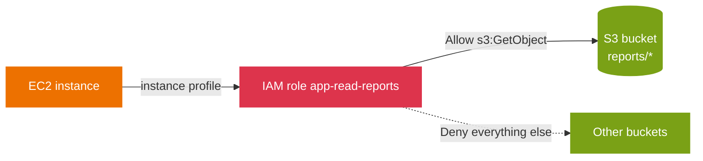

# Hands-on project: build a least-privilege instance role and audit it

This is the topic's practice project. It turns the policy model in [01-concepts.md](01-concepts.md) and the hardening guidance in [02-security.md](02-security.md) into a role you build, test, and audit. Nothing depends on it; it depends only on this topic.

## Goal

Create an EC2 instance role that can read one S3 prefix and nothing else, prove the boundary with the IAM policy simulator, and confirm the decision in CloudTrail.

## What you build

A role assumed by EC2 through an instance profile, with an inline policy scoped to a single bucket prefix, then a second statement gated on MFA. The point is the evaluation order, not the app.



## Prerequisites

- Read [01-concepts.md](01-concepts.md), [02-security.md](02-security.md), and [03-troubleshooting.md](03-troubleshooting.md) first.
- An AWS account, the AWS CLI configured, and an S3 bucket with an object under a `reports/` prefix.

## Steps

1. **Write the trust policy.** Only EC2 may assume the role.

   ```json
   {
     "Version": "2012-10-17",
     "Statement": [{
       "Effect": "Allow",
       "Principal": { "Service": "ec2.amazonaws.com" },
       "Action": "sts:AssumeRole"
     }]
   }
   ```

2. **Create the role.**

   ```bash
   aws iam create-role --role-name app-read-reports \
     --assume-role-policy-document file://trust.json
   ```

3. **Attach a least-privilege inline policy** scoped to one prefix, not the whole bucket.

   ```bash
   aws iam put-role-policy --role-name app-read-reports --policy-name read-reports \
     --policy-document '{
       "Version": "2012-10-17",
       "Statement": [{
         "Effect": "Allow",
         "Action": "s3:GetObject",
         "Resource": "arn:aws:s3:::example-bucket/reports/*"
       }]
     }'
   ```

4. **Create the instance profile** and add the role, which is how an EC2 instance receives the role.

   ```bash
   aws iam create-instance-profile --instance-profile-name app-read-reports
   aws iam add-role-to-instance-profile --instance-profile-name app-read-reports --role-name app-read-reports
   ```

5. **Add an MFA-gated statement** for a sensitive prefix, so the action requires an MFA-authenticated session.

   ```bash
   aws iam put-role-policy --role-name app-read-reports --policy-name read-payments \
     --policy-document '{
       "Version": "2012-10-17",
       "Statement": [{
         "Effect": "Allow",
         "Action": "s3:GetObject",
         "Resource": "arn:aws:s3:::example-bucket/payments/*",
         "Condition": { "Bool": { "aws:MultiFactorAuthPresent": "true" } }
       }]
     }'
   ```

## Validation

1. **Simulate the decision** for an allowed and a denied request. The first returns `allowed`; the second returns `implicitDeny` because no policy grants it.

   ```bash
   aws iam simulate-principal-policy --policy-source-arn arn:aws:iam::111122223333:role/app-read-reports \
     --action-names s3:GetObject \
     --resource-arns arn:aws:s3:::example-bucket/reports/q1.csv \
     --query 'EvaluationResults[].EvalDecision' --output text

   aws iam simulate-principal-policy --policy-source-arn arn:aws:iam::111122223333:role/app-read-reports \
     --action-names s3:GetObject \
     --resource-arns arn:aws:s3:::another-bucket/q1.csv \
     --query 'EvaluationResults[].EvalDecision' --output text
   ```

2. **Audit the decision in CloudTrail.** Look up recent S3 `GetObject` events and read the `userIdentity` to confirm which role made the call.

   ```bash
   aws cloudtrail lookup-events --lookup-attributes AttributeKey=EventName,AttributeValue=GetObject \
     --max-results 5 --query 'Events[].CloudTrailEvent' --output text
   ```

## Failure injection

- **Widen the resource.** Change `Resource` to `arn:aws:s3:::example-bucket/*` and re-run the simulator against `example-bucket/payments/q1.csv`; it now returns `allowed` without MFA, which shows how a scope that is too broad silently removes the intended boundary.
- **Explicit deny wins.** Add a `Deny` for `s3:GetObject` on `reports/secret/*` and confirm the simulator returns `explicitDeny` even though the `Allow` still matches. This is the evaluation rule [01-concepts.md](01-concepts.md) describes.

## Cleanup

Detach and remove everything the project created.

```bash
aws iam remove-role-from-instance-profile --instance-profile-name app-read-reports --role-name app-read-reports
aws iam delete-instance-profile --instance-profile-name app-read-reports
aws iam delete-role-policy --role-name app-read-reports --policy-name read-reports
aws iam delete-role-policy --role-name app-read-reports --policy-name read-payments
aws iam delete-role --role-name app-read-reports
```

## What it practices

- **Domain 4, Task 4.1 (secure access):** Skill 4.1.1, implement IAM features (roles, instance profiles, resource-scoped policies, policy conditions). Skill 4.1.2, troubleshoot and audit access with the policy simulator and CloudTrail.

## Sources

- AWS: *Creating a role for an AWS service*. https://docs.aws.amazon.com/IAM/latest/UserGuide/id_roles_create_for-service.html
- AWS: *Policy evaluation logic*. https://docs.aws.amazon.com/IAM/latest/UserGuide/reference_policies_evaluation-logic.html
- AWS: *iam simulate-principal-policy*. https://docs.aws.amazon.com/cli/latest/reference/iam/simulate-principal-policy.html
