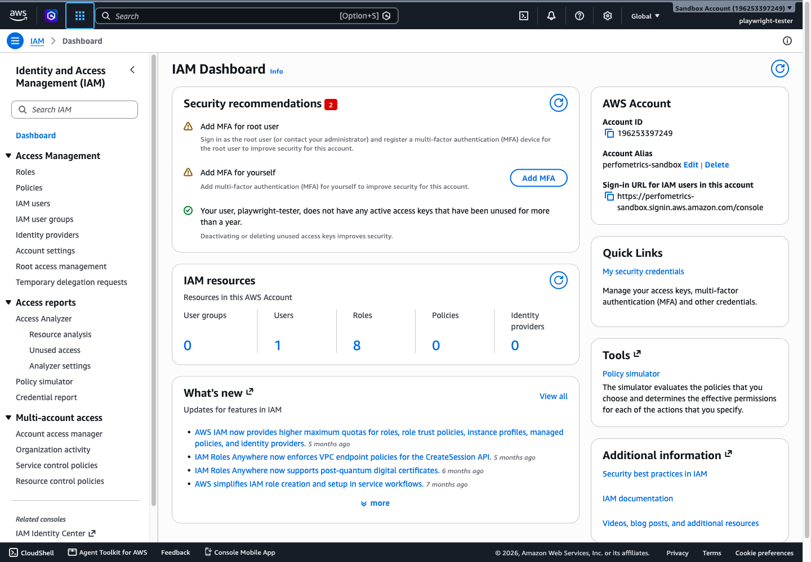
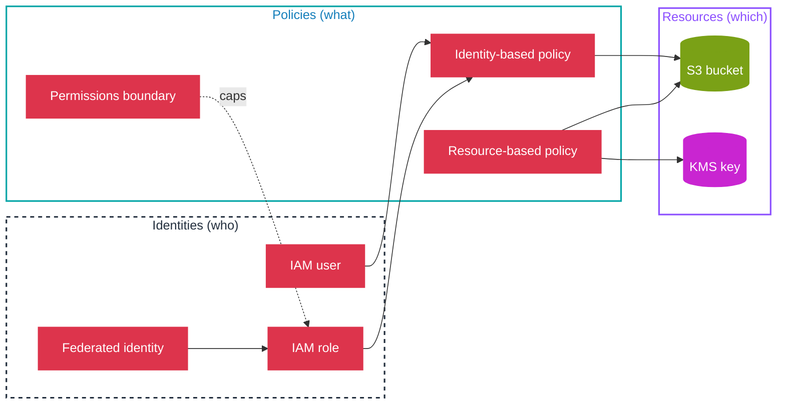
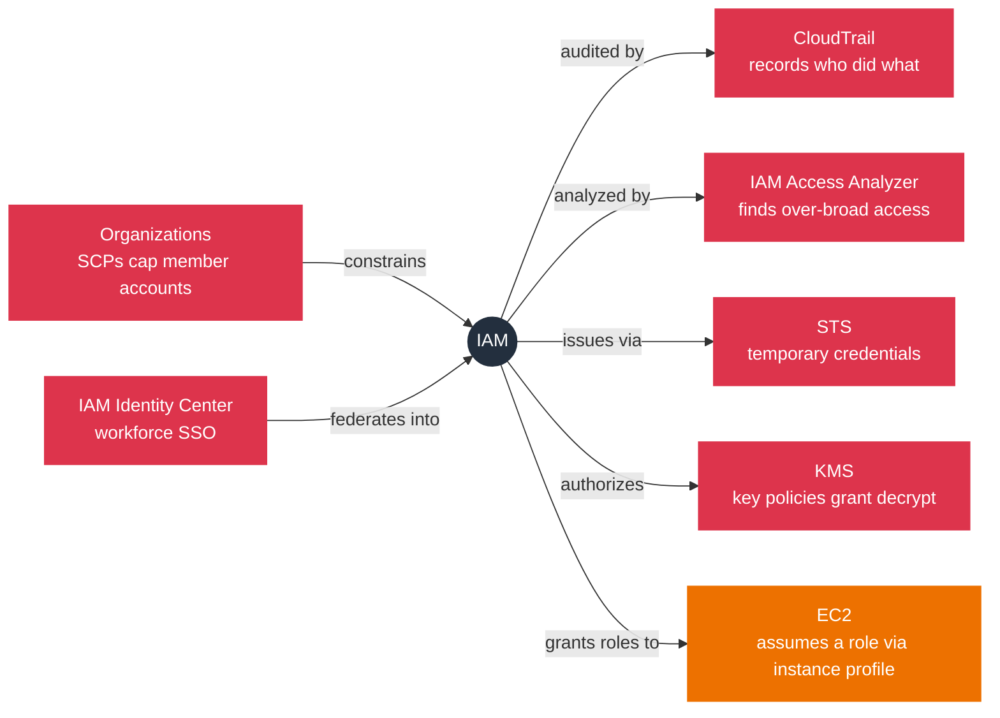

# AWS Identity and Access Management (IAM)

IAM is the AWS service that controls *who* (identity) can do *what* (permission) on *which* resources. Every other service in this repository assumes IAM in some form: an EC2 instance assumes a role to read an S3 bucket, a CloudFormation stack assumes a role to create resources, a user assumes a role to reach a database. It is the dependency that precedes everything else, which is why it is documented first.

## What IAM is

IAM manages two concerns in one service:

- **Authentication (who you are).** Principals: the root user, IAM users, IAM roles, federated identities. You prove identity with a password, access key, or temporary token.
- **Authorization (what you may do).** Policies attach to principals or resources and grant or deny actions on specific AWS resources.

IAM is global, not regional. Users, roles, and policies exist account-wide; a role created in one Region is usable in all Regions.

The IAM dashboard in the console is the first screen to open when reviewing an account. It summarizes the account's security posture and its IAM resource counts in a single view, which makes it the fastest orientation before drilling into users, roles, or policies.

*The IAM dashboard for the sandbox account. The Security recommendations panel and the resource counts on the left are the first things to check when auditing an account; the AWS Account panel on the right holds the account ID and the sign-in URL for IAM users.*

The pieces fit together as principals, policies, and resources. The diagram below groups them and shows the arrows between the groups: each arrow is one of those relationships.

Read it as three questions. An identity (who) has a policy attached; an identity-based policy grants what that identity may do; a resource-based policy grants who may touch a resource (which). The dashed arrow is different from the rest: a permissions boundary caps a role and can only remove access, never add it, which is why it points at the role rather than carrying a grant.

## SOA-C03 relevance

IAM is the backbone of **Domain 4: Security and Compliance (16%)**. The exam guide names it directly in three skills:

- **4.1.1**, Implement IAM features: password policies, MFA, roles, federated identity, resource policies, policy conditions.
- **4.1.2**, Troubleshoot and audit access: CloudTrail, IAM Access Analyzer, IAM policy simulator.
- **4.1.3**, Multi-account security: AWS Organizations, SCPs, IAM Identity Center.

IAM is not confined to Domain 4. Roles and instance profiles underpin Domain 3 (deployment/provisioning), and CloudTrail-based audit feeds Domain 1 (monitoring/logging). The canonical documentation lives here; those domains link back rather than repeat it.

## Topic mind map

IAM at a glance: it decides who can do what, and it sits between every caller and every resource. The map shows the services that constrain it, audit it, and depend on it.

Read the map outward from IAM: Organizations and its SCPs cap what the account itself may do, Identity Center federates human logins in, and STS issues the temporary credentials a role hands out. CloudTrail and Access Analyzer watch who used that access and where it is too broad, while KMS and a compute service such as EC2 depend on IAM to allow the call.

### Connection notes

- **Organizations and IAM.** An SCP sets the maximum permissions for a member account and never grants access, only caps it. A policy that allows an action still fails if an SCP does not allow it, which is why a denied request can survive every `Allow` in the account.
- **IAM Identity Center and IAM.** Identity Center federates workforce logins and maps them to permission sets that assume IAM roles in each account. People get short-lived role credentials instead of long-lived IAM users, which removes the access-key population you would otherwise rotate.
- **IAM and STS.** A role is only useful because STS issues the temporary credentials a principal assumes. Those credentials expire, which is the core reason a role is safer than an access key.
- **IAM and EC2.** An instance assumes a role through an instance profile, and the temporary credentials arrive through instance metadata. No keys are stored on the instance, so the role can be re-scoped without touching the host.
- **IAM and KMS.** An identity policy and a key policy are both evaluated, but the key policy is the gate. An `Allow` for `kms:Decrypt` still fails if the key policy does not also grant the principal, which is the usual cause of a decrypt failure.
- **IAM and CloudTrail.** IAM decides the request; CloudTrail records whether it was allowed or denied and by which principal. That record is the trail you read when an access question turns into an audit.

The `## Document index` below carries the links to this topic's documents.

## Document index (read in this order)

1. [01-concepts.md](01-concepts.md): principals, policy structure, and the policy evaluation logic.
2. [02-security.md](02-security.md): least privilege, MFA, password policy, permissions boundaries, SCPs.
3. [03-troubleshooting.md](03-troubleshooting.md): diagnosing an access-denied failure.
4. [04-comparisons.md](04-comparisons.md): role vs user, identity vs resource policy, managed vs inline.
5. [05-exam-traps.md](05-exam-traps.md): recurring misconceptions.
6. [06-limits-defaults.md](06-limits-defaults.md): quotas and defaults that matter.
7. [07-quick-review.md](07-quick-review.md): the must-know summary.

Each document ends with its own `Sources` section; there is no separate `sources.md`.

## Relationship map

- **Secured By**, itself (it is the security primitive).
- **Monitored By**, CloudTrail (API calls), IAM Access Analyzer (findings), Trusted Advisor (IAM checks).
- **Commonly Used With**, AWS Organizations, IAM Identity Center, AWS STS, KMS.
- **Automated By**, CloudFormation, CDK (provision roles and policies as code).

See also (cross-service and domain documents are planned, not yet created):

- Domain 4: Security and Compliance
- IAM + KMS (cross-service)
- IAM + Organizations (cross-service)
