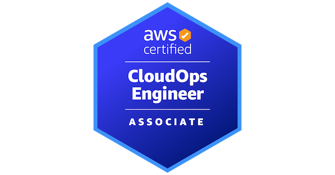
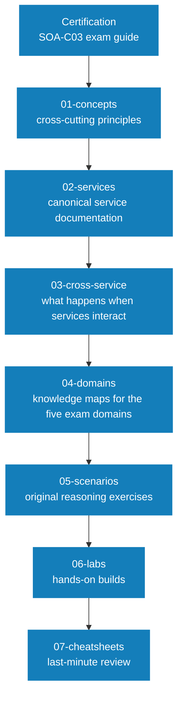

# ☁️ AWS CloudOps Engineer – Associate (SOA-C03)

**A certification-focused knowledge base for operating workloads on AWS.**

*Research it. Verify it. Write it down. Reason like a CloudOps engineer.*

---

## What this is

This repository exists to turn the SOA-C03 exam scope into a navigable knowledge graph, not another copy of the AWS documentation. The exam was formerly the AWS Certified SysOps Administrator – Associate. The repository connects the exam's requirements, verified AWS behavior, real operations, and cross-service relationships, so the reader learns **how AWS services actually behave** and **how to reason about them as an operator** rather than memorizing feature lists.

## Start here

The repository is meant to be read in this order: the exam guide defines the scope, the topics build the knowledge, and the closing triple tests and applies it.

1. **Read the exam guide** for scope, domains, tasks, and skills: [SOA-C03 exam guide (PDF)](assets/docs/soa-c03-exam-guide.pdf).
2. **Pick a topic** from [Documented topics](#documented-topics) and read its `README.md`, which maps the topic and links every document in order.
3. **Work the closing triple** of each topic: answer its `exam-questions`, review its `exam-traps`, then build its `hands-on-project`.
4. **Reinforce across services** through `03-cross-service` and the `04-domains` task maps as they are written.
5. **Review before the exam** with `07-cheatsheets`.

Every topic follows the same shape, so the method is the same everywhere.

## Documented topics

The table lists the topics documented so far, the type of each one, what it covers, and the folder to open first.

| Topic | Type | What it covers | Entry point |
|-------|------|----------------|-------------|
| IP addressing / CIDR | Concept | CIDR math, reserved addresses, subnets, public/private routing, NAT, peering | [README](01-concepts/01-networking/01-ip-addressing/README.md) |
| AWS Identity and Access Management | Service | Principals, policy evaluation, roles, boundaries, SCPs, auditing | [README](02-services/13-security-identity-compliance/01-iam/README.md) |
| AWS Systems Manager | Service | Managed nodes, patching, sessions, automation, Parameter Store, tagging | [README](02-services/10-management-governance/15-systems-manager/README.md) |

See [Progress](#progress) for what is documented, what is next, and the full [roadmap in `AGENTS.md`](AGENTS.md) (§11).

## How a topic is structured

Every topic folder follows the same pattern, numbered for read order, so you can move from concept to reference to practice without guessing what comes next.

- **`README.md`** is the entry point: a topic mind map, the SOA-C03 relevance, a linked document index, and a relationship map. It is the only file without a numeric prefix.
- **Numbered documents** (`01-...`, `02-...`) teach the topic: concepts, architecture, and operations, each with diagrams and screenshots.
- **The closing triple** is always the last three numbered files, in this order:
  1. `<NN>-exam-questions.md`: original, exam-style questions with a rationale for every option.
  2. `<NN+1>-exam-traps.md`: the distinctions and misconceptions that flip an answer.
  3. `<NN+2>-hands-on-project.md`: a standalone build that exercises the topic's services end to end.

Each document ends with a `## Sources` section.

## Repository map

The repository is organized as a reading order, from the underlying principles up to exam-day review.

Alongside those layers, `08-reference/` holds the source material (AWS documentation, whitepapers, prescriptive guidance, glossary), `assets/` holds the certification badge, the exam guide PDF, and the captured screenshots, and `99-archive/` holds historical and SOA-C02 material.

| Layer | Question it answers |
|-------|---------------------|
| `01-concepts/` | What is this fundamental CloudOps principle across AWS? |
| `02-services/` | What is this AWS service and how do I operate it? |
| `03-cross-service/` | What happens when two or more services interact? |
| `04-domains/` | How does this knowledge map to the exam's tasks and skills? |
| `05-scenarios/` | Can I reason through an operational problem end to end? |
| `06-labs/` | Can I build it? |
| `07-cheatsheets/` | What do I need to recall on exam day? |
| `08-reference/` | Where did this come from? |

Folders and files carry numeric prefixes that encode the read sequence (for example `01-concepts/01-networking/01-ip-addressing/`). Directories are created progressively as each topic is documented. Each major concept has **one canonical home**; related documents link to it rather than duplicating it.

## Exam domains and format

The table gives the five domains and their weights, which is the first thing to use when planning study time.

| # | Domain | Weight |
|---|--------|--------|
| 1 | Monitoring, Logging, Analysis, Remediation, and Performance Optimization | 22% |
| 2 | Reliability and Business Continuity | 22% |
| 3 | Deployment, Provisioning, and Automation | 22% |
| 4 | Security and Compliance | 16% |
| 5 | Networking and Content Delivery | 18% |

**Format:** 65 questions in 130 minutes, multiple-choice and multiple-response, no labs (50 scored and 15 unscored). Confirm the current numbers on the certification page before you book.

**Exam guide:** [AWS Certified CloudOps Engineer – Associate (SOA-C03), official exam guide (PDF)](assets/docs/soa-c03-exam-guide.pdf). This is the authoritative reference for certification scope.

> The in-scope AWS service list is non-exhaustive and changes over time. Never treat a static list as the complete exam definition.

## Progress

Documentation proceeds one topic at a time, following the [study roadmap in `AGENTS.md`](AGENTS.md) (§11).

| Status | Topic | Entry point |
|--------|-------|-------------|
| ✅ | IAM | [README](02-services/13-security-identity-compliance/01-iam/README.md) |
| ✅ | IP addressing / CIDR | [README](01-concepts/01-networking/01-ip-addressing/README.md) |
| ✅ | Systems Manager | [README](02-services/10-management-governance/15-systems-manager/README.md) |
| ⬜ | IPv4 vs IPv6 *(next)* | `01-concepts/01-networking/02-ipv4-ipv6/` |
| ⬜ | VPC | `02-services/12-networking-content-delivery/01-vpc/` |
| ⬜ | EC2 | `02-services/05-compute/01-ec2/` |
| ⬜ | CloudWatch | `02-services/10-management-governance/05-cloudwatch/` |

Each documented topic ships with its own exam-question set, exam-traps file, and hands-on project.

## Key principles

The build follows a short set of rules that decide what goes where, what gets linked, and what gets tested.

- **Canonical knowledge.** One source of truth per concept, linked, never duplicated.
- **Certification-first.** Every document maps to a specific SOA-C03 domain, task, or skill.
- **Verified facts.** Defaults, limits, and quotas are checked against current AWS documentation, never invented.
- **Original questions.** Exam-style practice written from public AWS knowledge; no exam dumps are copied.
- **Hands-on.** Every topic ends with a project that builds the services it documents.
- **Cross-service thinking.** The exam rewards understanding how services compose, not isolated memorization.

## How this repository is built

The research, architecture, diagramming, screenshot, and writing methodology (including the exam-question sourcing rules) is defined in [`AGENTS.md`](AGENTS.md).

---

**Certification guide:** [AWS Certified CloudOps Engineer – Associate](https://aws.amazon.com/certification/certified-cloudops-engineer-associate/)

